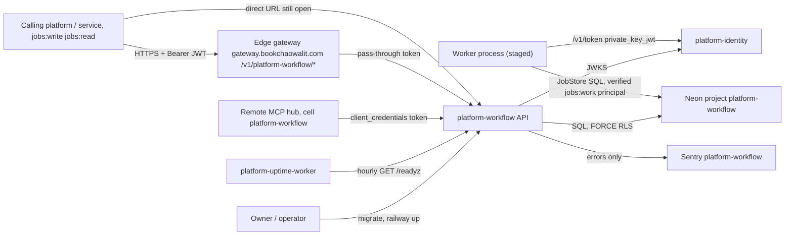
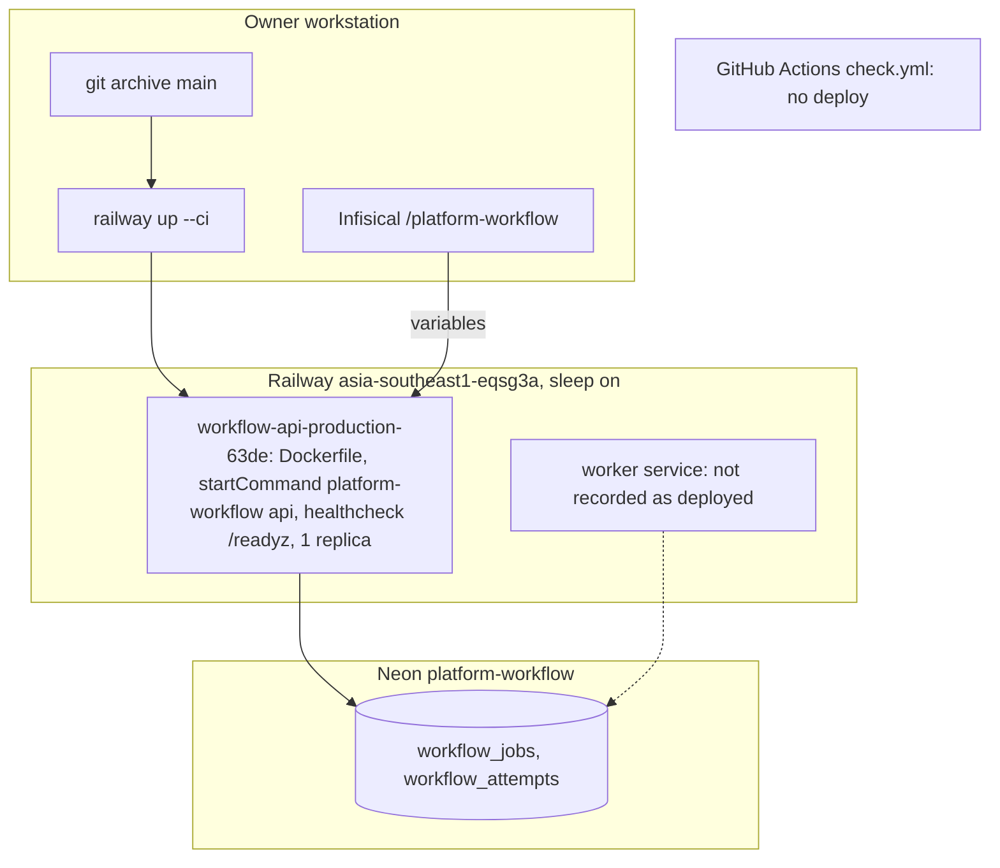

# Book Workflow Platform — System Architecture

เอกสารนี้สรุปสถาปัตยกรรมของ `platform-workflow` จากโค้ดและ config ใน repo ณ `origin/main` `6471458` (2026-11-04)
ข้อมูล hosting ที่ไม่อยู่ใน repo อ้างจาก ops record: book-platforms-status (2026-11-03) และ routes ของ platform-api-gateway
รายละเอียดเชิงลึกอยู่ใน Core 22 diagram pack [`docs/diagrams/`](../docs/diagrams/README.md) — เอกสารนี้ลิงก์ไป ไม่คัดลอก

> หมายเหตุ: subtitle ใน `docpack.yaml` ("ยังไม่มี runtime"), `README.md`, `PRODUCT.md`, `docs/RUNBOOK.md` และ `docs/RUNTIME.md`
> ยังเขียนว่า "not deployed" แต่ ops record บันทึก `workflow-api-production-63de` live ตั้งแต่ 2026-10-29; tier ยังเป็น `L0` ตามเดิม

## 1. Architecture style และเหตุผล

| ด้าน | รูปแบบที่ใช้ | เหตุผล / หลักฐาน |
|---|---|---|
| ขอบเขตระบบ | microservice ของ Book Platform ที่เป็นเจ้าของ **execution state** ของ job; business invariant อยู่ที่ platform ผู้เรียก | `contract.json`, `docs/gates/BOO-165-scheduler-ownership-retry-history.md` (อ้าง platform-repository-split) |
| รูปแบบ async | durable job queue บน PostgreSQL (ไม่ใช้ broker): `SELECT … FOR UPDATE SKIP LOCKED`, lease + `lease_token` fencing, at-least-once | `store.py`, [ADR-0002](../docs/diagrams/08-adr/ADR-0002-postgres-durable-queue-with-lease-fencing.md) |
| โครงภายใน | image เดียว, CLI สาม command: `api` (FastAPI), `worker` (sequential poller ที่ใช้ `JobStore` ตรงกับ DB), `migrate` | `cli.py`, `Dockerfile`, `.railway/railway.ts` |
| shared runtime | `platform-backend-core` pin commit `dc1fa7d` (มี `ServiceTokenSource`) — ต่างจาก service อื่นที่ยัง pin `21d5f44` | `pyproject.toml` `[tool.uv.sources]`, [ADR-0001](../docs/diagrams/08-adr/ADR-0001-fastapi-on-pinned-platform-backend-core.md) |
| multi-tenancy | JWT `ws` ที่ verify แล้ว + FORCE RLS + runtime role ที่ bypass RLS ไม่ได้; worker ไม่รับ workspace จาก env | `cli.py` comment ใน `main()`, [ADR-0003](../docs/diagrams/08-adr/ADR-0003-workspace-isolation-jwt-ws-and-force-rls.md) |
| hosting | Railway Docker serverless, healthcheck `/readyz`, CLI deploy | `.railway/railway.ts`, [ADR-0004](../docs/diagrams/08-adr/ADR-0004-railway-docker-serverless-cli-deploy.md) |

## 2. Quality-attribute scenarios

| QA | Scenario (stimulus → response) | กลไกในโค้ด | หลักฐาน |
|---|---|---|---|
| Reliability (at-least-once) | worker ตายระหว่างทำ job → lease หมดอายุ แล้ว worker อื่น claim ใหม่ได้ | `lease_until`, claim เลือก job ที่ lease หมด; lease 1..900 s | `store.py` (`claim`, `_lease_seconds`) |
| Correctness (fencing) | worker เก่าที่ lease หลุดพยายาม `complete` → `LeaseLost`, ผลไม่ถูกบันทึก | `_fenced` เทียบ `status`, `lease_token`, `lease_until` กับนาฬิกา DB หลัง row lock | `store.py` |
| Idempotency | producer enqueue ซ้ำด้วย key เดิม → ได้ job เดิม; payload ต่าง → 409 | `idempotency_key` + fingerprint SHA-256 ของ payload/option | `store.py` (`enqueue`), `app.py` handler `conflict` |
| Retry / backoff | handler ล้ม → job กลับเป็น `queued` ด้วย backoff `min(3600, 2^attempts)` s จนครบ `max_attempts` (1..100, default 3) แล้วเป็น `dead` | `fail()` SQL | `store.py` |
| Concurrency | worker หลายตัว claim พร้อมกัน → ไม่ได้ job ซ้ำ และไม่ block กัน | `FOR UPDATE SKIP LOCKED` | `store.py` |
| Security / authz | producer ไม่มี `jobs:write` enqueue, หรือ token ไม่มี `jobs:work` เรียก `/v1/worker/*` → 403 | `require_scope` ทุก route + `_scope` ใน store | `app.py`, `store.py` |
| Security / worker token | worker ได้ token `jobs:work` จาก identity `client_credentials` (`private_key_jwt`) และ verify ใหม่ก่อนทุก poll; identity ล่ม → รอ 30 s ไม่ crash | `ServiceTokenSource`, `worker_principal` | `cli.py`, `tests/runtime/test_worker_authorization.py` |
| Input bounds | payload เกิน 65,536 bytes หรือ result เกิน 16,384 bytes (JSONB) → ปฏิเสธ | `_json`, `_database_json_bound` | `store.py` |
| Availability | deploy ใหม่ที่ DB ยังไม่พร้อม → Railway ไม่ตัดไป instance ใหม่ | `healthcheckPath = "/readyz"`, timeout 20 s, restart ON_FAILURE ×3 | `.railway/railway.ts`, `app.py` (`readyz`) |
| Privacy (telemetry) | handler exception มีข้อมูลผู้ใช้ → Sentry ไม่ได้รับข้อความ; job เก็บแค่ error code ปลอดภัย (`handler_failed`, `unknown_handler`) | `_scrub_event`, `CaptureErrors`, `_name(error_code)` | `_sentry.py`, `worker.py`, [ADR-0005](../docs/diagrams/08-adr/ADR-0005-sentry-errors-only-no-free-text.md) |

## 3. Context diagram

ภาพ C4 แบบเต็ม: [05-c4-context.md](../docs/diagrams/05-c4-context.md), [06-c4-container.md](../docs/diagrams/06-c4-container.md), [07-c4-component.md](../docs/diagrams/07-c4-component.md)

## 4. Components / containers

| Container / module | เทคโนโลยี | หน้าที่ | หลักฐาน |
|---|---|---|---|
| API (`platform-workflow api`) | Python 3.12, FastAPI, uvicorn, core `dc1fa7d` | `POST/GET /v1/jobs`, `GET /v1/jobs/{id}`, `/attempts`, `POST /cancel`; worker protocol `POST /v1/worker/claim`, `/v1/worker/jobs/{id}/renew`, `/complete`, `/fail`; `/healthz`, `/readyz` (override), `/metrics` | `app.py`, `cli.py` |
| Worker (`platform-workflow worker`) | Python CLI, `Worker` + `JobStore` | poll ทีละ job, heartbeat renew ทุก lease/3, built-in handler เดียว `health.noop`; application ต้อง embed `Worker` พร้อม handler registry ของตัวเอง | `worker.py`, `cli.py` |
| `JobStore` | psycopg ผ่าน core `Database` | enqueue, claim, renew, complete, fail, cancel ใน transaction ต่อ workspace | `store.py` |
| `migrate` | CLI | `MigrationRunner(namespace='workflow')` ด้วย `DATABASE_URL` ของ migration role | `cli.py`, `migrations.py` |
| `_sentry` | sentry-sdk | opt-in เมื่อมี `SENTRY_DSN` | `_sentry.py` |

Component view (C4 level 3): [07-c4-component.md](../docs/diagrams/07-c4-component.md)

## 5. Tech stack

| ชั้น | เทคโนโลยี | หลักฐาน |
|---|---|---|
| Runtime | Python 3.12 | `pyproject.toml`, `Dockerfile` |
| Web | FastAPI `>=0.115,<1`, uvicorn `>=0.30,<1` (ไม่ได้ตั้ง `limit_concurrency` ต่างจาก media/data) | `pyproject.toml`, `cli.py` |
| DB client | psycopg[binary,pool] `>=3.2,<4` | `pyproject.toml` |
| Shared core | `platform-backend-core==0.1.0` git rev `dc1fa7d2693594b3c79b0b2539a83a6a9465a560` | `pyproject.toml`, `uv.lock` |
| Observability | sentry-sdk `>=2.72,<3`, `/metrics` ของ core | `pyproject.toml` |
| Build | 2-stage `python:3.12-slim`, `uv sync --frozen --no-dev`, user `65532:65532`, builder `DOCKERFILE` | `Dockerfile`, `.railway/railway.ts` |

## 6. Data stores

| Store | ข้อมูล | หมายเหตุ | หลักฐาน |
|---|---|---|---|
| PostgreSQL (Neon project `platform-workflow`) | `workflow_jobs` (status, queue, payload, result, lease, attempts), `workflow_attempts` (ประวัติแต่ละ attempt), `platform_schema_migrations` | FORCE RLS; pool API `WORKFLOW_POOL_MAX` default 8, worker default 2 | `migrations.py`, `cli.py`, [09-erd.md](../docs/diagrams/09-erd.md) |

## 7. Integrations

| ระบบ | ทิศทาง | ใช้ทำอะไร | สถานะ / หลักฐาน |
|---|---|---|---|
| platform-identity | workflow → identity | API: verify RS256 ผ่าน JWKS (`JWT_ISSUER`/`WORKFLOW_JWT_ISSUER`, `JWT_AUDIENCE`/`WORKFLOW_JWT_AUDIENCE`, `JWT_JWKS_URL`/`WORKFLOW_JWKS_URL`, หรือ public key); worker: `<issuer>/v1/token` ด้วย `WORKFLOW_WORKER_CLIENT_ID` + `WORKFLOW_WORKER_PRIVATE_KEY_PEM` (หรือ `WORKFLOW_WORKER_AUTHORIZATION` แบบ static) | API live; worker token ยังเป็น owner follow-up (ops record) |
| Edge gateway | caller → gateway → workflow | ingress `/v1/platform-workflow/<path>`, token pass-through | route `platform-workflow` ใน platform-api-gateway `routes.json` @ `4a31ff5`; workflow ไม่เช็ค `X-Gateway-Assertion` |
| Remote MCP hub | hub → workflow | cell `platform-workflow` (ตรวจด้วย `call_cell` 200) | ops record (2026-11-03) |
| Neon PostgreSQL | API + worker → DB | `DATABASE_URL` | live (API) |
| Sentry | workflow → Sentry | errors ไม่มี free text | project `platform-workflow` (ops record) |
| platform-uptime-worker | uptime → workflow | `GET /readyz` ทุกชั่วโมง | ops record |
| Schedulers เดิม (systemd timers, GH Actions cron) | — | BOO-165 inventory 69 jobs ยังไม่ย้ายมา workflow | `docs/gates/BOO-165-…md`, `scripts/scheduler_inventory.py` |
| Queues / Kafka / R2 | — | ไม่มี: queue อยู่ใน PostgreSQL เอง | ไม่พบใน `src/` |
| `observability` platform | ประกาศใน `depends_on` | ยังไม่มีการเรียก | `contract.json` |

## 8. Deployment topology

- deploy เป็น CLI จาก `git archive main`; ops record ระบุเฉพาะ API service — worker และ migrate one-off ไม่มีบันทึกว่ารันบน Railway
- รายละเอียด: [16-deployment.md](../docs/diagrams/16-deployment.md), [15-cicd-pipeline.md](../docs/diagrams/15-cicd-pipeline.md), [`docs/RUNBOOK.md`](../docs/RUNBOOK.md)

## 9. ADR สำคัญ

| ID | การตัดสินใจ | ไฟล์ |
|---|---|---|
| ADR-0001 | FastAPI บน `platform-backend-core` ที่ pin commit | [ADR-0001](../docs/diagrams/08-adr/ADR-0001-fastapi-on-pinned-platform-backend-core.md) |
| ADR-0002 | PostgreSQL durable queue + lease fencing, at-least-once | [ADR-0002](../docs/diagrams/08-adr/ADR-0002-postgres-durable-queue-with-lease-fencing.md) |
| ADR-0003 | Workspace isolation: JWT `ws` + FORCE RLS + non-bypass role | [ADR-0003](../docs/diagrams/08-adr/ADR-0003-workspace-isolation-jwt-ws-and-force-rls.md) |
| ADR-0004 | Railway Docker serverless, CLI deploy | [ADR-0004](../docs/diagrams/08-adr/ADR-0004-railway-docker-serverless-cli-deploy.md) |
| ADR-0005 | Sentry errors only, no free text | [ADR-0005](../docs/diagrams/08-adr/ADR-0005-sentry-errors-only-no-free-text.md) |

## 10. Fitness functions

| สิ่งที่ guard | Check | ที่รัน |
|---|---|---|
| lock resolve core commit ที่ review แล้ว; dependency จาก lock เท่านั้น; image multi-stage non-root; `.dockerignore` | `tests/test_build_hygiene.py` | `check.yml` |
| workflow action pin SHA เต็ม | `test_every_workflow_action_is_sha_pinned` | `check.yml` |
| vendored schema ตรง canonical; contract ตรง registry | `scripts/check_schema_pin.py`, `scripts/check_registry_alignment.py`, `tests/test_drift_checks.py`, `scripts/check.py` | `check.yml` |
| lease fencing, idempotency, retry/dead, RLS | `tests/runtime/test_jobs.py`, `tests/runtime/test_app_worker.py`, `tests/runtime/test_error_mapping.py` | `check.yml` → reusable `ci-python.yml` @ `87dc5e1c` |
| worker token ที่ได้จาก identity และ fail-safe | `tests/runtime/test_worker_authorization.py` | `check.yml` |
| ไม่มี free text ออกไป Sentry | `tests/test_sentry.py`, `tests/runtime/test_sentry_boundary.py` | `check.yml` |
| scheduler inventory BOO-165 ไม่เพี้ยน | `scripts/scheduler_inventory.py`, `tests/test_scheduler_inventory.py` | `check.yml` |
| coverage ≥ 77% | `coverage-threshold: "77"` | `check.yml` |
| dependency / secret scan | reusable `security.yml` @ `87dc5e1c` | `check.yml` |

## 11. เอกสารลงรายละเอียด phase 07

| Template | สถานะ | ลิงก์ / เหตุผล |
|---|---|---|
| `sdlc/infrastructure-and-network-design.md` | partial (ใช้ diagram แทน) | [16-deployment.md](../docs/diagrams/16-deployment.md), [19-service-dependency-map.md](../docs/diagrams/19-service-dependency-map.md) |
| `sdlc/observability-design.md` | partial | [20-observability.md](../docs/diagrams/20-observability.md); ไม่มี SLO และไม่มี metric ของ queue depth / dead jobs |
| `sdlc/capacity-performance-and-cost-plan.md` | not_applicable | tier L0; ไม่มี load test / cost model |
| `sdlc/failure-mode-analysis.md` | partial | [13-threat-model.md](../docs/diagrams/13-threat-model.md), [14-backup-dr.md](../docs/diagrams/14-backup-dr.md), [21-incident-response.md](../docs/diagrams/21-incident-response.md), [`docs/RUNBOOK.md`](../docs/RUNBOOK.md) |
| `sdlc/async-integration-contract.md` | partial (สำคัญสำหรับ service นี้) | semantics อยู่ใน [`docs/RUNTIME.md`](../docs/RUNTIME.md), [10-sequences.md](../docs/diagrams/10-sequences.md), [11-state-machines.md](../docs/diagrams/11-state-machines.md); ยังไม่มีเอกสารตาม template (DLQ = status `dead`, ไม่มี outbox) |
| `sdlc/frontend-architecture.md` | not_applicable | ไม่มี UI |
| `sdlc/tech-debt-register.md` | partial | [`docs/UPGRADE-PLAN.md`](../docs/UPGRADE-PLAN.md) |
| `operations/system-landscape.md` | done (row มีแล้ว) | architecture-docs `operations/platform/SYSTEM-LANDSCAPE-GENERATED.md` @ `2107a91`: `platform-workflow` online, railway/serverless, Operations & Delivery |
| `development-cycle/vendor-dependency-review.md` | not_applicable (ยังไม่ทำ) | Railway, Neon, Sentry free tier; ยังไม่มี exit plan |

## 12. Open questions

- worker จะรันที่ไหน (Railway service แยก?) และ handler ของ application จริงตัวแรกคืออะไร — วันนี้มีแค่ `health.noop`
- `WORKFLOW_WORKER_CLIENT_ID` / private key ของ worker ลงทะเบียนใน identity แล้วหรือยัง (owner follow-up)
- audience จริงคือ `workflow-api` ตาม pattern หรือไม่
- ควรตั้ง `limit_concurrency` ให้ API เหมือน media/data หรือไม่
- ไม่มี retention ของ job/attempt ที่จบแล้ว และไม่เก็บ `sub` ผู้ enqueue บน job (non-repudiation, ดู [13-threat-model.md](../docs/diagrams/13-threat-model.md))
- จะปิด direct Railway URL หลัง gateway cutover หรือไม่
- ควรอัปเดต product card / README / RUNBOOK ที่ยังเขียนว่า "not deployed"

## การอนุมัติ

| บทบาท | สถานะ | วันที่ | ลงนาม |
|---|---|---|---|
| Solution Architect (Book Dev) | รอตรวจ | — | [ต้องยืนยัน] |
| Owner | รอตรวจ | — | [ต้องยืนยัน] |

## แหล่งข้อมูล

- repo `platform-workflow` ที่ `origin/main` `6471458` (2026-11-04)
- `pyproject.toml`, `Dockerfile`, `.railway/railway.ts`, `uv.lock`, `contract.json`, `DOCPACK/docpack.yaml`, `DOCPACK/00-product-card.md`
- `src/platform_workflow/cli.py`, `app.py`, `store.py`, `worker.py`, `migrations.py`, `_sentry.py`
- `.github/workflows/check.yml`, `scripts/*.py`, `scripts/check.sh`, `tests/**`
- `docs/RUNTIME.md`, `docs/RUNBOOK.md`, `docs/CONTRACT-SURFACE.md`, `docs/UPGRADE-PLAN.md`, `docs/gates/BOO-165-scheduler-ownership-retry-history.md`, `docs/diagrams/*` (pack ที่ `301da88`, แก้ `6471458`)
- platform-api-gateway `routes.json` และ `README.md` @ `4a31ff5`
- architecture-docs `operations/platform/SYSTEM-LANDSCAPE-GENERATED.md` @ `2107a91`
- ops record: book-platforms-status (2026-11-03), api-gateway-edge (2026-11-03)
