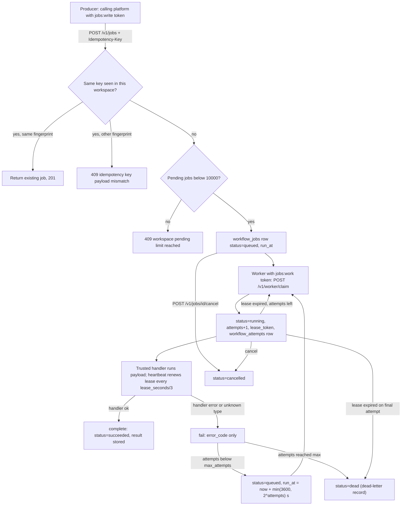
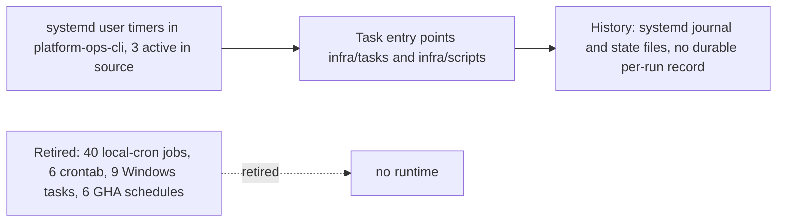
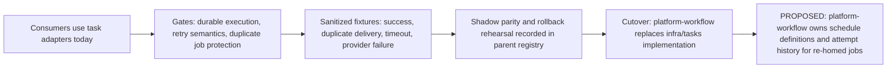

# 01 — Business process (As-Is / To-Be)

`platform-workflow` เป็น platform service เจ้าของ capability `workflow` (jobs, queue, retry, execution history) ของ Book Platform
งานจริงที่โค้ดทำวันนี้คือ **durable jobs queue** บน PostgreSQL: producer ส่ง job เข้า, worker claim ด้วย lease, ผลลัพธ์ถูกเก็บเป็น attempt history
business invariant อยู่ใน platform ที่เรียกใช้ ไม่ได้อยู่ที่นี่ (`docs/CONTRACT-SURFACE.md` "Behaviour notes")

## As-Is (จากโค้ดวันนี้)

Sources: `src/platform_workflow/app.py`, `src/platform_workflow/store.py`, `src/platform_workflow/worker.py`, `src/platform_workflow/migrations.py`, `docs/RUNTIME.md`

### As-Is ของ scheduling เดิม (นอก repo นี้)

contract ยังระบุ interface ปัจจุบันเป็น `infra/tasks` และ `infra/scripts` (`current-in-solo-empire`) แต่ gate BOO-165 พบว่า path นี้ย้ายไป `platform-ops-cli` แล้ว
inventory 69 jobs (3 systemd timer ที่ยัง active ใน source, ที่เหลือ retired) ได้รับการ accept โดย owner 2026-10-16 — ดูรายละเอียดใน [BOO-165 gate](../gates/BOO-165-scheduler-ownership-retry-history.md) (reused)

Sources: `docs/gates/BOO-165-scheduler-ownership-retry-history.md`, `contract.json`, `docs/CONTRACT-SURFACE.md`, `fixtures/gates/workflow-scheduler-inventory.json`

## To-Be (จาก PRODUCT.md, UPGRADE-PLAN.md และ gate doc เท่านั้น)

Sources: `PRODUCT.md`, `docs/UPGRADE-PLAN.md`, `README.md` ("Migration gate"), `contract.json` (`migration`, `migration_gates`), `docs/gates/BOO-165-scheduler-ownership-retry-history.md` ("Still open")

ข้อสังเกต: กล่อง `OWN` และกฎ retry `max_attempts = 2`, idempotency key `(job_id, scheduled_for)` ยังเป็น **PROPOSED, NOT ACCEPTED** ตาม gate doc

## Open questions

- contract ประกาศ capability `scheduler` และ `approval` แต่โค้ดไม่มี recurring schedule (มีแค่ `run_at` ครั้งเดียว) และไม่มี approval เลย — จะทำใน repo นี้หรือถอดออกจาก contract?
- ข้อเสนอ ownership/retry/idempotency/history 7 ข้อใน BOO-165 ยังรอ owner ตัดสิน
- consumer รายแรกที่จะย้ายมาใช้ queue นี้คือใคร (gate doc เสนอ 3 systemd timer ของ platform-ops-cli)
