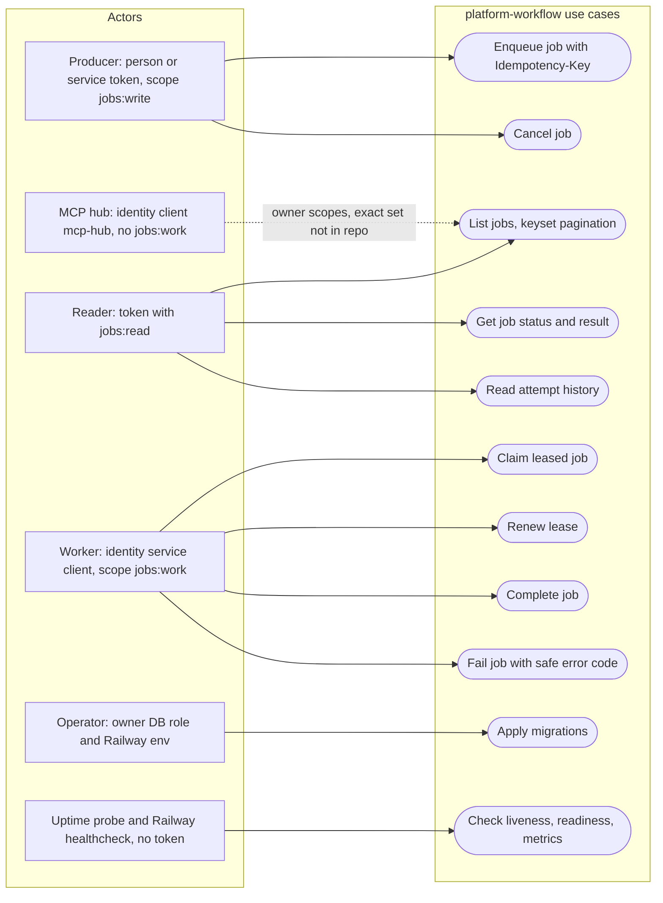

# 02 — Use cases

actor คือสิ่งที่ service ตรวจจริง: JWT ที่ verify แล้ว (issuer, audience, `ws` workspace UUID) และ **exact scope** 3 ตัว `jobs:read`, `jobs:write`, `jobs:work`
ไม่มี owner/wildcard override (`docs/RUNTIME.md`) และ token ที่มี claim `del`/`obo` ถูกปฏิเสธ (core `TokenVerifier`)
endpoint ที่ไม่ต้อง auth คือ `/healthz`, `/readyz`, `/metrics`

Sources: `src/platform_workflow/app.py`, `src/platform_workflow/store.py` (`_scope`), `src/platform_workflow/cli.py`, `docs/RUNTIME.md`, `platform-backend-core@dc1fa7d:src/platform_backend_core/http.py` (`require_scope`, `/healthz`, `/metrics`), `platform-backend-core@dc1fa7d:src/platform_backend_core/auth.py` (`TokenVerifier.verify`), ops record: book-platforms-status (2026-11-03) (MCP hub cell, "no jobs:work")

## Scope matrix

| Use case | Scope | ตรวจที่ |
|---|---|---|
| Enqueue, Cancel | `jobs:write` | `require_scope` ใน route + `_scope` ใน `JobStore` |
| List, Get, Attempts | `jobs:read` | เหมือนกัน |
| Claim, Renew, Complete, Fail | `jobs:work` | เหมือนกัน |
| Migrate | ไม่มี JWT; ใช้ `DATABASE_URL` ของ migration role | `cli.py migrate` |
| Health/ready/metrics | ไม่มี | core + `app.py` `/readyz` |

ทุก use case ที่มี scope ทำงานใน workspace เดียวจาก claim `ws` เท่านั้น; body ที่มี field แปลก (เช่น workspace) ถูกปฏิเสธเพราะ `extra='forbid'`

## Open questions

- MCP hub ถือ scope ของ workflow ตัวไหนบ้าง (ops record บอกเพียงว่าไม่มี `jobs:work` และ `call_cell` workflow ได้ 200)
- person token ยังใช้ไม่ได้จนกว่า owner ตั้ง `IDENTITY_GOOGLE_CLIENT_IDS` (ops record) — producer จริงตอนนี้คือใคร
- ไม่มี actor "approver" แม้ contract จะมี capability `approval`
