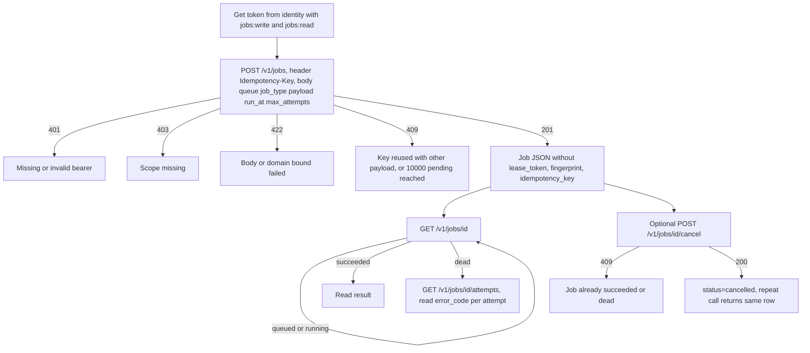
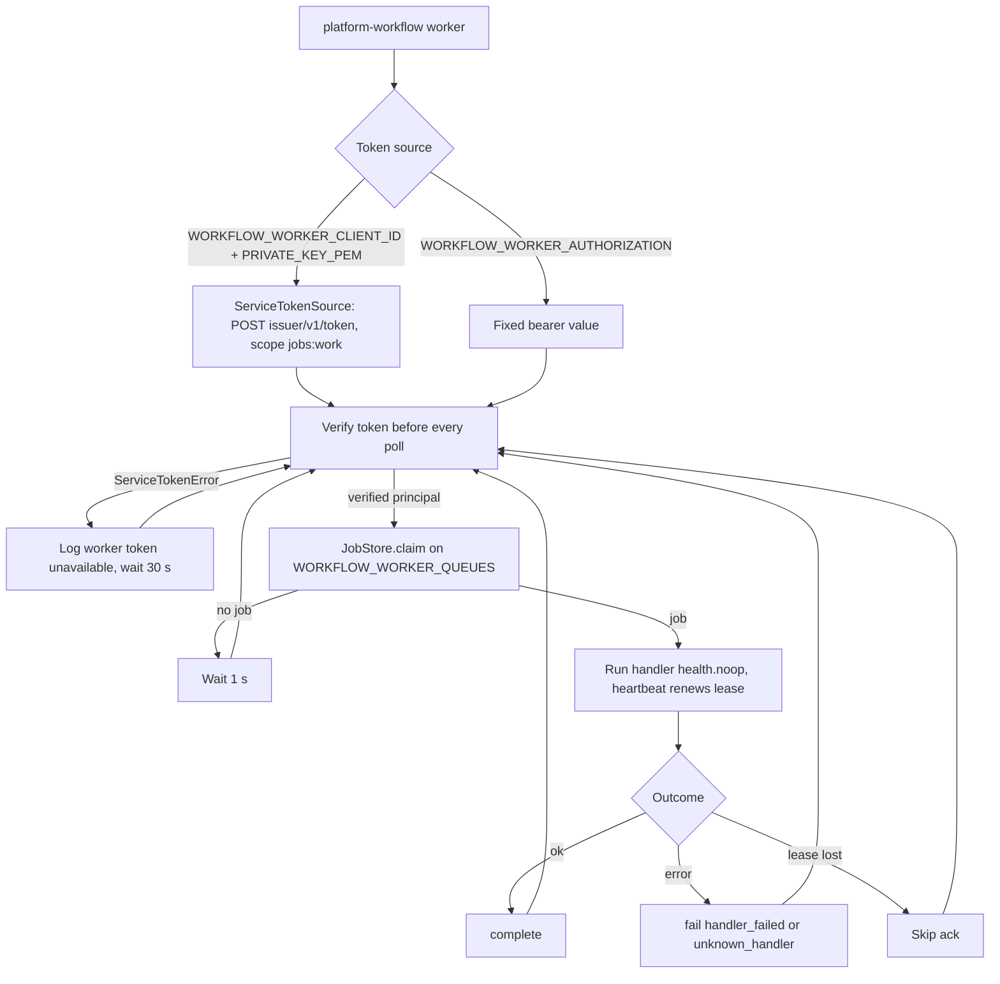
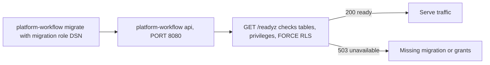

# 03 — User flows (API call flows per caller)

service นี้ไม่มี UI; "user flow" คือลำดับ API call ของแต่ละ caller

## Producer: enqueue แล้วติดตามผล

Sources: `src/platform_workflow/app.py`, `src/platform_workflow/store.py`, `docs/RUNTIME.md` (endpoint table)

## Worker: poll loop ของ CLI worker

CLI worker เป็น diagnostic fixture: handler มีแค่ `health.noop` (`cli.py`); product จริงต้อง embed `Worker` พร้อม handler registry ของตัวเอง
worker เรียก `JobStore` ตรงผ่าน database ไม่ได้เรียก HTTP `/v1/worker/*` (endpoint HTTP ใช้สำหรับ worker ภายนอกที่ทำ protocol เดียวกัน)

Sources: `src/platform_workflow/cli.py`, `src/platform_workflow/worker.py`, `platform-backend-core@dc1fa7d:src/platform_backend_core/service_token.py`, `docs/RUNTIME.md` ("Workers")

## Operator: release step

Sources: `docs/RUNBOOK.md`, `src/platform_workflow/cli.py`, `src/platform_workflow/app.py` (`readyz`), `railway.toml`

## Open questions

- ยังไม่มี caller จริงของ `/v1/jobs` ใน repo (ไม่มี consumer adapter); ใครคือ producer รายแรกหลัง cutover
- worker service client ยังไม่ได้ตั้ง ("The workflow worker token" อยู่ใน owner follow-ups ของ ops record) — จะ deploy worker เป็น service แยกเมื่อไร
