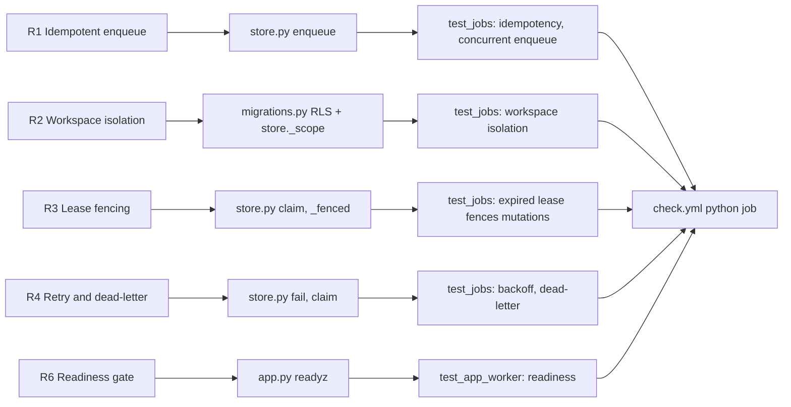

# 04 — Traceability (RTM)

ไม่มี `specs/` ใน repo; requirement มาจาก `PRODUCT.md`, `docs/RUNTIME.md`, `docs/RUNBOOK.md`, `contract.json` (`migration_gates`) และ gate BOO-165
release ทุกแถวผ่าน `.github/workflows/check.yml` (jobs `contract`, `python`, `security`, `image`); deploy เป็น CLI นอก repo (ดู [16-deployment.md](16-deployment.md))

Sources: ตามตารางด้านล่าง

| # | Requirement (source) | Code module | Test file / test | Release gate |
|---|---|---|---|---|
| R1 | Enqueue with required `Idempotency-Key`; same key + same fingerprint replays, other payload = 409 (`docs/RUNTIME.md`, gate "duplicate job protection" in `contract.json`) | `store.py` `enqueue`, `migrations.py` `UNIQUE(workspace_id,operation,idempotency_key)` | `tests/runtime/test_jobs.py` `test_idempotency_conflict_and_workspace_isolation`, `test_concurrent_enqueue_once_backlog_bound_and_missing_context` | `check.yml` `python` |
| R2 | Verified JWT `ws` is the only workspace authority; FORCE RLS (`docs/RUNTIME.md`, `docs/RUNBOOK.md`) | `migrations.py` policies, `store.py` `_scope`, core `Database.transaction` | `test_jobs.py` `test_idempotency_conflict_and_workspace_isolation`; `test_app_worker.py` `test_verified_api_scope_workspace_and_worker_flow` | `python` |
| R3 | Lease fencing: cannot renew/ack/fail an expired or replaced token (gate "durable execution") | `store.py` `claim`, `_fenced`, `renew` | `test_jobs.py` `test_distinct_claims_in_independent_processes`, `test_expired_lease_recovers_and_fences_all_mutations`; `test_app_worker.py` `test_worker_renews_long_running_handler` | `python` |
| R4 | Retry `min(3600, 2^attempts)` s, dead at `max_attempts`; expired final attempt = dead-letter (gate "retry semantics") | `store.py` `fail`, `claim` | `test_jobs.py` `test_scheduling_backoff_dead_letter_and_cancellation`, `test_expired_final_attempt_is_dead_letter` | `python` |
| R5 | Cancel queued/running; idempotent; terminal = 409 | `store.py` `cancel` | `test_jobs.py` `test_scheduling_backoff_dead_letter_and_cancellation` | `python` |
| R6 | `/readyz` 503 on missing migration, privilege or RLS (`docs/RUNBOOK.md`) | `app.py` `readyz` | `test_app_worker.py` `test_readiness_denies_missing_service_schema`, `test_readiness_requires_each_runtime_table_privilege` | `python` |
| R7 | Bounded input; only `InvalidInput` → 422, other errors → redacted 500 (`docs/RUNTIME.md` 2026-10-29) | `store.py` `_json`, `_name`, `app.py` handlers | `test_error_mapping.py` (5 tests); `test_jobs.py` `test_bounds_and_scope_fail_before_work`, `test_jsonb_expansion_is_validated_before_inserting`, `test_literal_backslash_unicode_escape_is_valid_payload_and_result`; `test_app_worker.py` `test_unsupported_json_strings_return_api_422` | `python` |
| R8 | Completion replay with JSONB-equal result is idempotent | `store.py` `complete` | `test_jobs.py` `test_scientific_notation_completion_replay_is_idempotent` | `python` |
| R9 | Worker token from identity service client, exactly one source (`docs/RUNTIME.md` "Workers") | `cli.py` `worker_authorization_from_env`, `worker_principal` | `tests/runtime/test_worker_authorization.py` (7 tests) | `python` |
| R10 | Worker records safe codes only (`handler_failed`, `unknown_handler`, `invalid_result`) | `worker.py` | `test_app_worker.py` `test_worker_injected_handlers_success_and_safe_failure`, `test_worker_invalid_json_result_records_safe_failure` | `python` |
| R11 | Sentry: no free text, no PII, opt-in by `SENTRY_DSN` (`docs/RUNBOOK.md`, `PRODUCT.md`) | `_sentry.py` | `tests/test_sentry.py` (12 tests), `tests/runtime/test_sentry_boundary.py` | `contract` (unittest) + `python` |
| R12 | `contract.json` valid against pinned schema; README/surface agree (`README.md`) | `scripts/check.py`, `scripts/check_schema_pin.py` | `tests/test_contract_check.py`, `tests/test_drift_checks.py` | `contract` |
| R13 | Scheduler inventory BOO-165 stays in step with sources | `scripts/scheduler_inventory.py`, `fixtures/gates/*.json` | `tests/test_scheduler_inventory.py` | `contract` (re-extracts platform-ops-cli at pinned SHA) |
| R14 | Image builds from clean checkout, non-root, actions SHA-pinned (`docs/RUNTIME.md` build hygiene) | `Dockerfile`, `.dockerignore`, `check.yml` | `tests/test_build_hygiene.py` | `contract` + `image` |
| R15 | Capability `approval`, `scheduler` (recurring) (`contract.json`) | **none** | **none** | gap |
| R16 | Fixtures for success, duplicate delivery, timeout, provider failure (`README.md` "Migration gate", `docs/UPGRADE-PLAN.md` P1) | **none** | **none** | gap |

Sources: `PRODUCT.md`, `README.md`, `contract.json`, `docs/RUNTIME.md`, `docs/RUNBOOK.md`, `docs/UPGRADE-PLAN.md`, `src/platform_workflow/*.py`, `tests/**/*.py`, `.github/workflows/check.yml`

## Open questions

- R15/R16: จะเพิ่ม requirement ใน spec และ test หรือถอด capability ออกจาก contract
- RTM ไม่มี link ไป release/deploy id เพราะ deploy เป็น `railway up` ไม่ผูก tag ใน git
