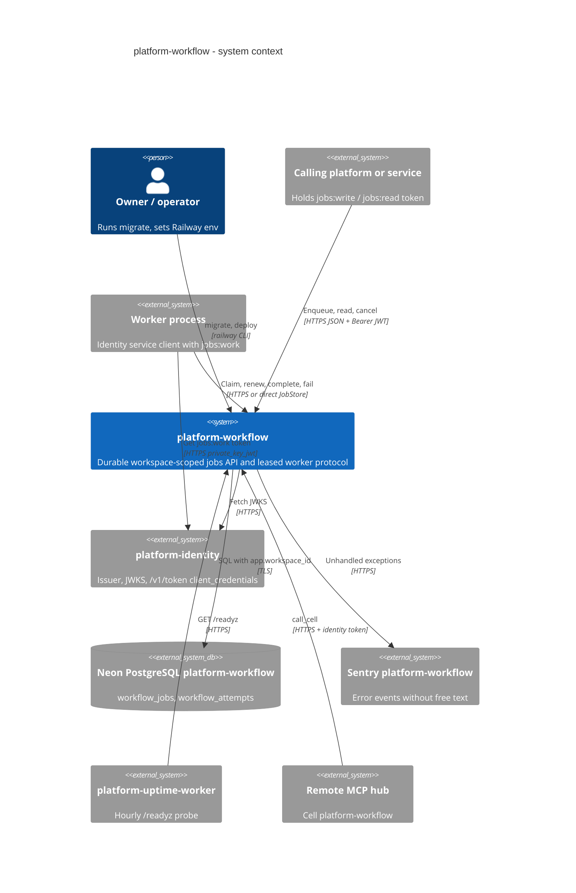

# 05 — C4 Context

ยังไม่มีภาพ C4 ของ service นี้ใน central architecture-docs ([C4-DIAGRAMS.md](https://github.com/bookchaowalit/architecture-docs/blob/main/docs/architecture/C4-DIAGRAMS.md) ไม่ได้กล่าวถึง platform-workflow) จึงวาดใหม่

Sources: `src/platform_workflow/cli.py` (`verifier_from_env`, `worker_authorization_from_env`), `src/platform_workflow/app.py`, `src/platform_workflow/_sentry.py`, `docs/RUNBOOK.md`, `contract.json` (`depends_on`: identity, observability), ops record: book-platforms-status (2026-11-03) (Neon project `platform-workflow`, Sentry `platform-workflow`, uptime worker, MCP hub cell, identity issuer)

## Open questions

- edge gateway (`gateway.bookchaowalit.com`) มี route ไป workflow หรือไม่ — ops record ที่อ้างได้ไม่ได้ระบุ
- `observability` อยู่ใน `depends_on` แต่ไม่มีโค้ดเรียก observability platform (มีแค่ `/metrics` และ Sentry)
