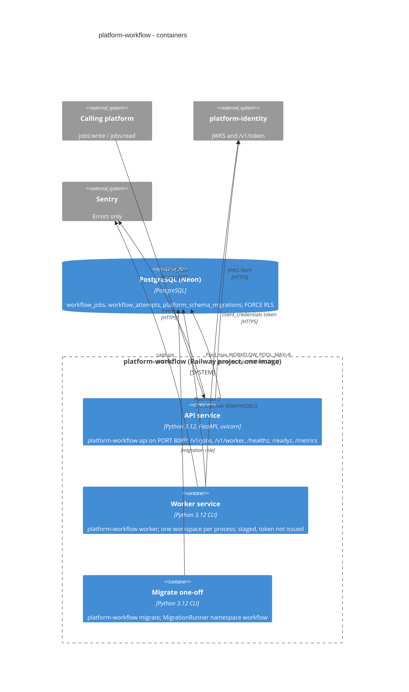

# 06 — C4 Container

image เดียว (`Dockerfile`) รันได้ 3 command: `api` (default CMD และ `railway.toml` startCommand), `worker`, `migrate`

Sources: `Dockerfile`, `railway.toml`, `src/platform_workflow/cli.py`, `src/platform_workflow/migrations.py`, `docs/RUNBOOK.md`, `docs/RUNTIME.md` ("Container image", "Workers"), `platform-backend-core@dc1fa7d:src/platform_backend_core/migrations.py` (`platform_schema_migrations`), ops record: book-platforms-status (2026-11-03) ("The workflow worker token" in owner follow-ups)

## Open questions

- worker และ migrate รันเป็น Railway service/one-off จริงหรือไม่ — ops record บอกเฉพาะ `workflow-api-production-63de`
- `WORKFLOW_POOL_MAX` ใน production ตั้งไว้เท่าไร และงบ connection ของ Neon free project เท่าไร
