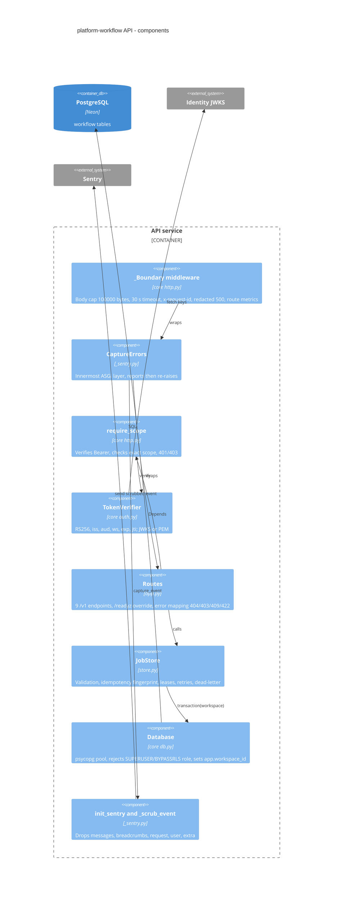
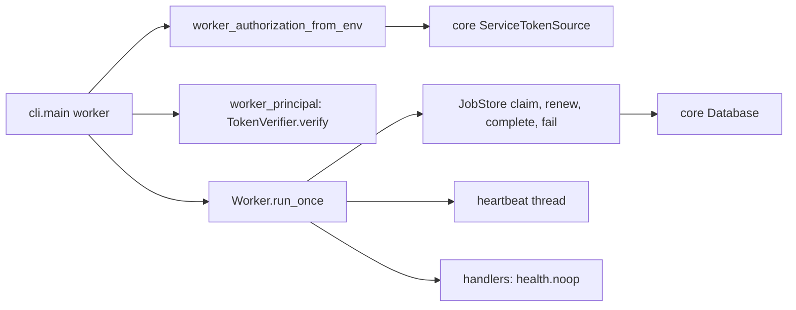

# 07 — C4 Component (API service)

Sources: `src/platform_workflow/app.py`, `src/platform_workflow/store.py`, `src/platform_workflow/_sentry.py`, `src/platform_workflow/__init__.py`, `platform-backend-core@dc1fa7d:src/platform_backend_core/http.py`, `platform-backend-core@dc1fa7d:src/platform_backend_core/auth.py`, `platform-backend-core@dc1fa7d:src/platform_backend_core/db.py`

## Worker components

Sources: `src/platform_workflow/cli.py`, `src/platform_workflow/worker.py`

## Open questions

- core commit: `pyproject.toml` pin `dc1fa7d` แต่ `docs/RUNTIME.md` ยังเขียน `21d5f44` — เอกสารต้องอัปเดต
