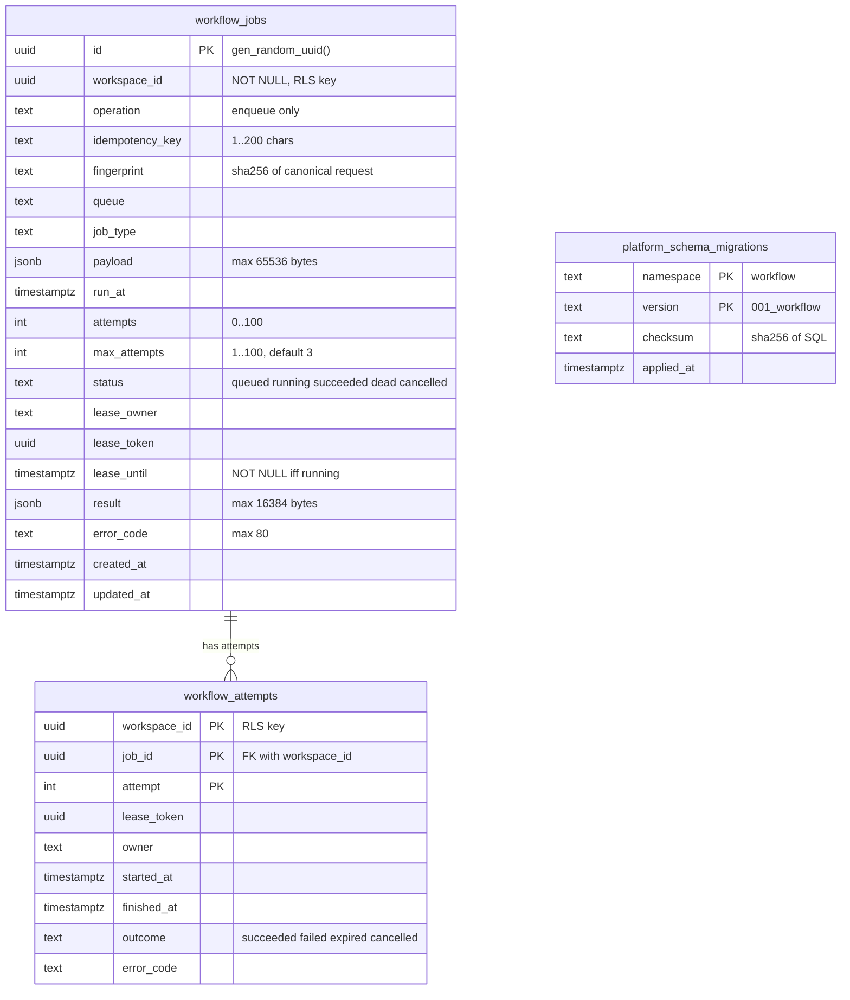

# 09 — ERD

schema มาจาก migration เดียว `001_workflow` (`src/platform_workflow/migrations.py`) และตาราง ledger ของ core `MigrationRunner`
central [ERD-DIAGRAMS.md](https://github.com/bookchaowalit/architecture-docs/blob/main/docs/architecture/ERD-DIAGRAMS.md) ไม่มีตารางของ service นี้

Sources: `src/platform_workflow/migrations.py`, `platform-backend-core@dc1fa7d:src/platform_backend_core/migrations.py`

## Constraints, indexes และ RLS

| Object | Rule |
|---|---|
| `workflow_jobs` | `UNIQUE(workspace_id, operation, idempotency_key)`, `UNIQUE(workspace_id, id)`, `CHECK ((status='running') = (lease_until IS NOT NULL))` |
| index `workflow_jobs_poll` | `(workspace_id, queue, status, run_at, created_at, id)` |
| `workflow_attempts` | PK `(workspace_id, job_id, attempt)`, FK `(workspace_id, job_id)` → `workflow_jobs(workspace_id, id)` |
| RLS | ทั้งสองตาราง `ENABLE` + `FORCE ROW LEVEL SECURITY`; policy `USING` และ `WITH CHECK` = `workspace_id = NULLIF(current_setting('app.workspace_id', true), '')::uuid` ไม่มี workspace = เห็น 0 แถว |
| Runtime role | NOSUPERUSER/NOBYPASSRLS; schema USAGE + SELECT/INSERT/UPDATE บนสองตาราง; ไม่มี DDL, ไม่มี DELETE (`docs/RUNBOOK.md`); core ปฏิเสธ role ที่ bypass ได้ |
| Migration | advisory lock + checksum; ห้ามแก้ checksum หรือ drop table ตอน rollback |

Sources: `src/platform_workflow/migrations.py`, `docs/RUNBOOK.md`, `src/platform_workflow/app.py` (`readyz` privilege query), `platform-backend-core@dc1fa7d:src/platform_backend_core/db.py`

## Open questions

- ชื่อ runtime role ใน Neon `platform-workflow` (ops record ระบุชื่อ role เฉพาะของ security/payment)
- retention ของ terminal job และ idempotency key ยังไม่กำหนด (`docs/RUNTIME.md`: "requires an environment-specific retention plan")
