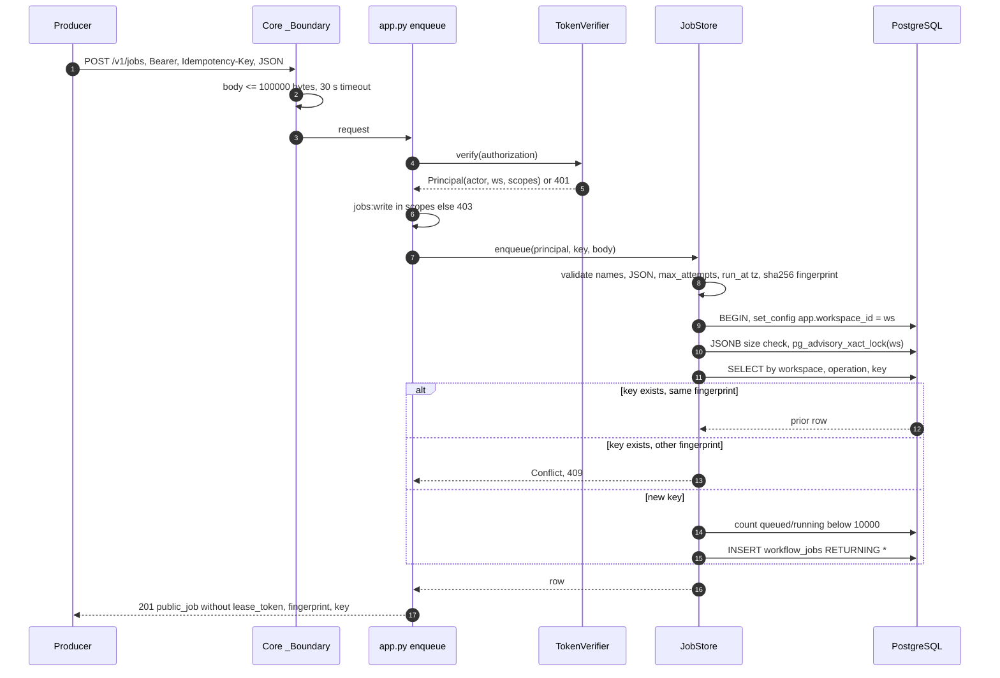
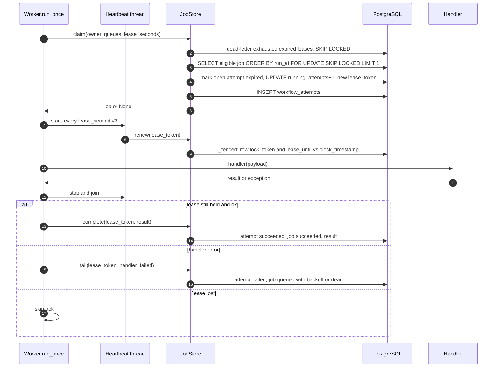
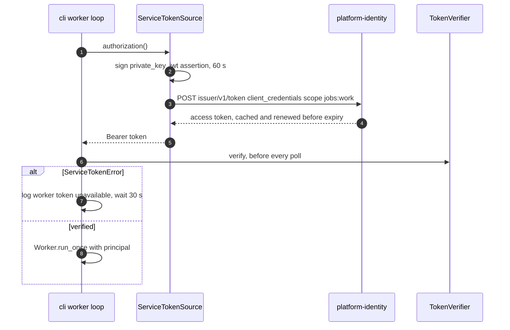
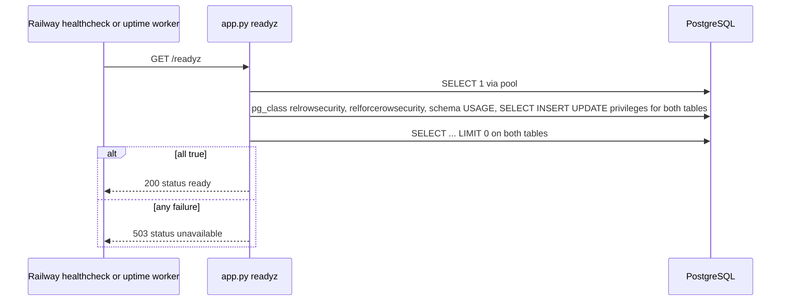

# 10 — Sequences

## 1. Enqueue (idempotent)

Sources: `src/platform_workflow/app.py`, `src/platform_workflow/store.py`, `platform-backend-core@dc1fa7d:src/platform_backend_core/http.py`, `platform-backend-core@dc1fa7d:src/platform_backend_core/auth.py`, `platform-backend-core@dc1fa7d:src/platform_backend_core/db.py`

## 2. Worker claim → heartbeat → complete / fail

Sources: `src/platform_workflow/worker.py`, `src/platform_workflow/store.py`

## 3. Worker token from identity (service client)

Sources: `src/platform_workflow/cli.py`, `platform-backend-core@dc1fa7d:src/platform_backend_core/service_token.py`, `docs/RUNTIME.md` ("Workers")

## 4. Readiness probe

Sources: `src/platform_workflow/app.py`, `.railway/railway.ts`, ops record: book-platforms-status (2026-11-03) (uptime worker hourly `/readyz`)
