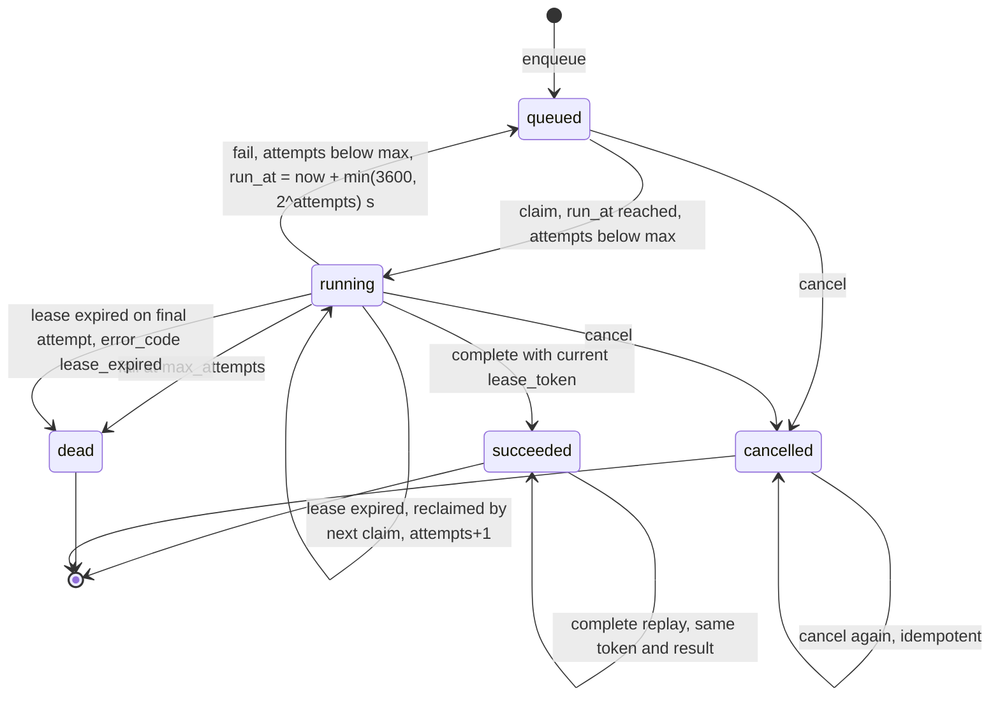
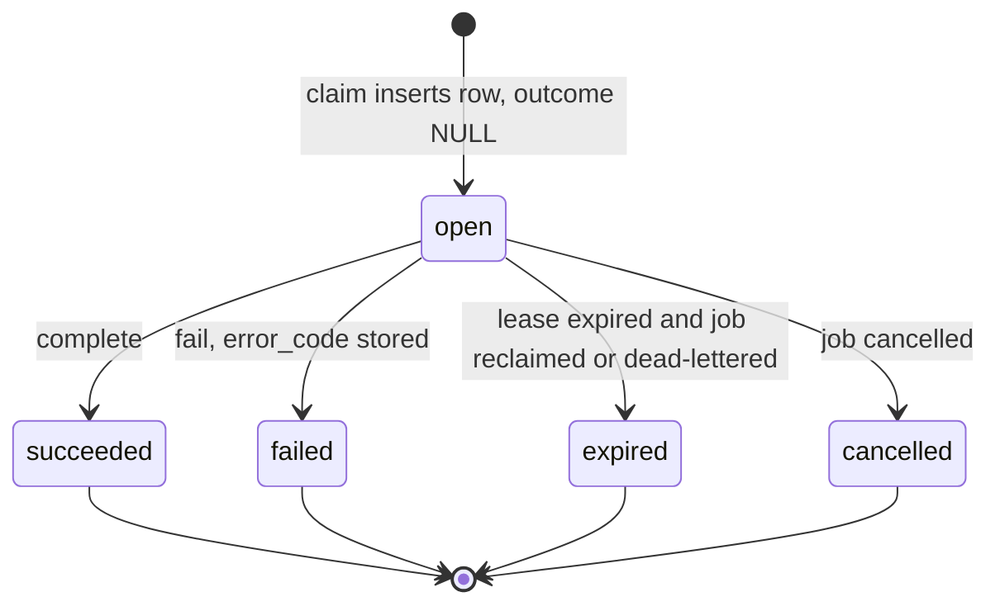
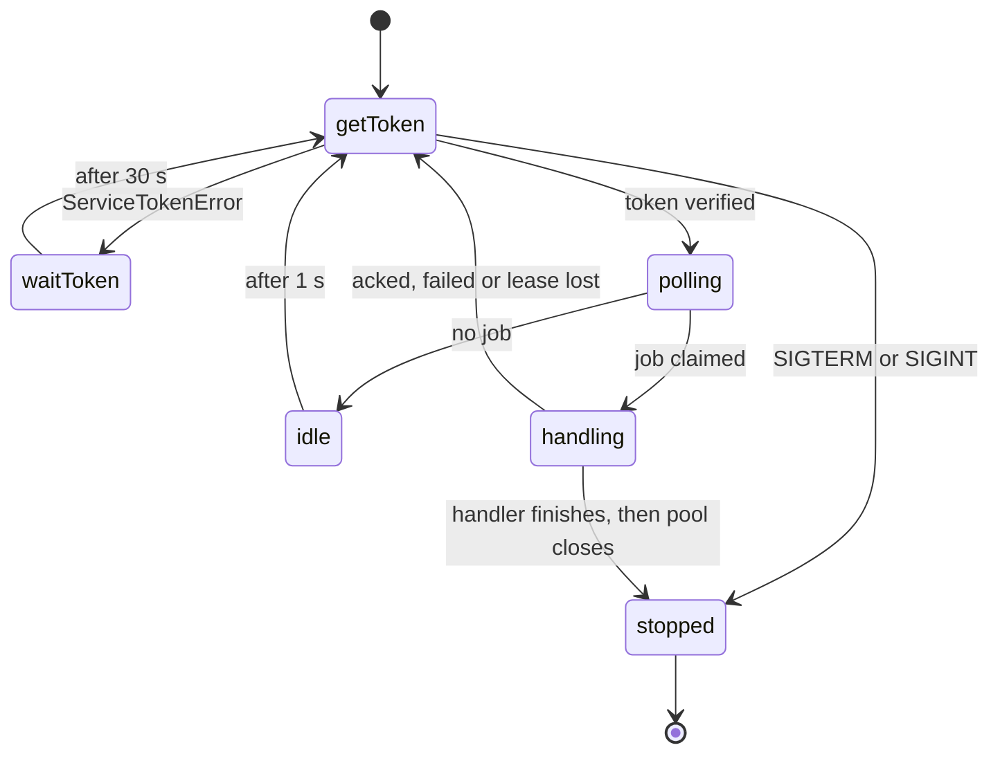

# 11 — State machines

## Job (`workflow_jobs.status`)

กติกาเพิ่ม: `succeeded`/`dead` cancel ไม่ได้ (409); DB `CHECK` บังคับว่า `lease_until` มีค่าก็ต่อเมื่อ `running`; ไม่มี transition ออกจาก `dead` (ไม่มี replay endpoint)

Sources: `src/platform_workflow/store.py` (`claim`, `renew`, `complete`, `fail`, `cancel`), `src/platform_workflow/migrations.py`, `docs/RUNTIME.md` ("Durability and limits")

## Attempt (`workflow_attempts.outcome`)

Sources: `src/platform_workflow/store.py`, `src/platform_workflow/migrations.py`

## Worker process

Sources: `src/platform_workflow/cli.py`, `src/platform_workflow/worker.py`, `docs/RUNBOOK.md`
