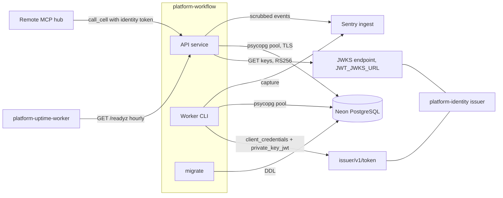

# 12 — API & integrations

รายการ endpoint ครบตาม router (`app.py`) + route ของ core; ตารางพฤติกรรมเต็มอยู่ใน [docs/RUNTIME.md](../RUNTIME.md) "Interfaces" (reused) — หน้านี้เพิ่ม idempotency และ error mapping ต่อ route

## Endpoints

| Method | Path | Scope | Idempotency behaviour | Responses |
|---|---|---|---|---|
| POST | `/v1/jobs` | `jobs:write` | header `Idempotency-Key` (1–200) บังคับ; key ซ้ำ + fingerprint เดิม → คืน job เดิม 201; fingerprint ต่าง → 409 | 201, 401, 403, 409, 422 |
| GET | `/v1/jobs?limit=1..100&after=uuid` | `jobs:read` | read-only | 200 `{items}` |
| GET | `/v1/jobs/{job_id}` | `jobs:read` | read-only; job ของ workspace อื่น → 404 | 200, 404 |
| GET | `/v1/jobs/{job_id}/attempts` | `jobs:read` | read-only; ตัด `lease_token`, `owner` | 200, 404 |
| POST | `/v1/jobs/{job_id}/cancel` | `jobs:write` | เรียกซ้ำบน cancelled คืนแถวเดิม; succeeded/dead → 409 | 200, 404, 409 |
| POST | `/v1/worker/claim` | `jobs:work` | ไม่ idempotent: claim ใหม่ = attempt ใหม่ | 200 job หรือ `null`, 422 |
| POST | `/v1/worker/jobs/{job_id}/renew` | `jobs:work` | fenced ด้วย `lease_token`; ซ้ำได้ระหว่าง lease ยังไม่หมด | 200, 409 lease lost |
| POST | `/v1/worker/jobs/{job_id}/complete` | `jobs:work` | replay ด้วย token เดิม + result เท่ากันแบบ JSONB → คืนผลเดิม; result ต่าง → 409 | 200, 409, 422 |
| POST | `/v1/worker/jobs/{job_id}/fail` | `jobs:work` | fenced; ซ้ำหลัง fail → 409 (lease ถูกปล่อยแล้ว) | 200, 409, 422 |
| GET | `/healthz` | none | – | 200 `{status: ok}` |
| GET | `/readyz` | none | – | 200 / 503 |
| GET | `/metrics` | none | – | Prometheus text: `platform_http_requests_total{route,status}`, `platform_http_request_duration_seconds_sum` |

ทุก route: body > 100000 bytes → 413, เกิน 30 s → 504, exception อื่น → redacted 500, ทุก response มี `x-request-id`; request schema ผิด → 422 `invalid request`

Sources: `src/platform_workflow/app.py`, `src/platform_workflow/store.py`, `platform-backend-core@dc1fa7d:src/platform_backend_core/http.py`, `docs/RUNTIME.md`

## External integrations

| Integration | Direction | Config | Code |
|---|---|---|---|
| Identity JWKS / PEM | outbound | `JWT_ISSUER`, `JWT_AUDIENCE`, one of `JWT_PUBLIC_KEY` / `JWT_JWKS_URL` (aliases `WORKFLOW_*`) | `cli.py` `verifier_from_env`, core `auth.py` |
| Identity token endpoint | outbound (worker) | `WORKFLOW_WORKER_CLIENT_ID`, `WORKFLOW_WORKER_PRIVATE_KEY_PEM` or `WORKFLOW_WORKER_AUTHORIZATION` | `cli.py`, core `service_token.py` |
| PostgreSQL | outbound | `DATABASE_URL`, `WORKFLOW_POOL_MAX` | core `db.py` |
| Sentry | outbound | `SENTRY_DSN`, `SENTRY_ENVIRONMENT`, `RAILWAY_GIT_COMMIT_SHA`/`SENTRY_RELEASE`, `RAILWAY_SERVICE_NAME` | `_sentry.py` |
| Uptime worker, MCP hub | inbound | – | ops record: book-platforms-status (2026-11-03) |

ไม่มี webhook, ไม่มี event bus, ไม่มี provider SDK อื่น; handler ไม่รัน command/URL ที่ caller ส่งมา (`docs/RUNTIME.md`)

Sources: `src/platform_workflow/cli.py`, `src/platform_workflow/_sentry.py`, `docs/RUNBOOK.md`, `pyproject.toml` (dependencies), ops record: book-platforms-status (2026-11-03)

## Open questions

- contract interface `workflow.cli.task-includes` / `workflow.cli.scripts` ยังชี้ `infra/tasks` ใน solo-empire ซึ่ง BOO-165 พบว่าย้ายไป `platform-ops-cli` แล้ว (gap 1)
- `/metrics` เปิดโดยไม่ต้อง auth บน public Railway domain — ตั้งใจหรือไม่
