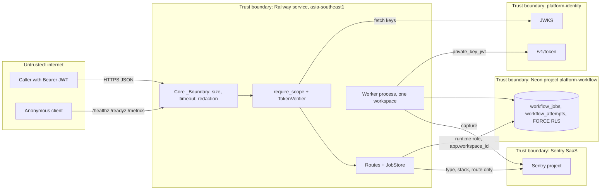

# 13 — Threat model

central [ATTACK-PATH-DIAGRAMS.md](https://github.com/bookchaowalit/architecture-docs/blob/main/docs/architecture/ATTACK-PATH-DIAGRAMS.md) ไม่ครอบคลุม service นี้

## DFD with trust boundaries

Sources: `src/platform_workflow/app.py`, `src/platform_workflow/store.py`, `src/platform_workflow/cli.py`, `src/platform_workflow/_sentry.py`, `src/platform_workflow/migrations.py`, `platform-backend-core@dc1fa7d:src/platform_backend_core/{http,auth,db,service_token}.py`, ops record: book-platforms-status (2026-11-03) (region, Neon project, identity issuer)

## STRIDE per element

| Element | Threat | Existing mitigation (code) | Gap |
|---|---|---|---|
| API edge | **S** forged token | RS256 only, `iss`/`aud` strict, require `sub ws iat exp jti`, lifetime ≤ 3600 s, reject `del`/`obo`, `crit` (core `auth.py`) | no revocation check (core comment: "cannot enforce delegation status or revocation") |
| API edge | **T** oversized / malformed body | 100000-byte cap, `extra='forbid'`, JSON NUL/surrogate rejection, JSONB size re-check (`app.py`, `store.py`) | – |
| API edge | **D** request flood | 30 s timeout, pool bound, 10000 pending per workspace (`store.py`) | no rate limit in repo; gateway in front not confirmed |
| API edge | **I** `/metrics` public | route templates only, no raw paths (core `http.py`) | unauthenticated on public domain |
| Routes / JobStore | **E** cross-workspace access | `ws` from token only, exact scopes, `_scope` re-check in store | – |
| Routes / JobStore | **R** who did what | `x-request-id` log line, `workflow_attempts` owner + lease_token | `actor` (`sub`) not stored on job or attempt |
| Routes / JobStore | **I** lease secret leak | `public_job` strips `lease_token`, `lease_owner`, `fingerprint`, `idempotency_key`; attempts strip token/owner | claim/renew responses return full row incl. `lease_token` to the worker (by design) |
| Worker | **S** stolen worker key | key from env, never logged (`service_token.py`), token verified before every poll | key storage = Railway/Infisical, not in repo |
| Worker | **T** handler runs after lease lost | fencing on every mutation, at-least-once documented | external effects need provider idempotency (`docs/RUNTIME.md`) |
| Neon DB | **E** RLS bypass | FORCE RLS, NOBYPASSRLS enforced by core `_configure`, `/readyz` checks RLS + grants | runtime role grants applied by hand (`docs/RUNBOOK.md`), not by migration |
| Neon DB | **D** connection exhaustion | pool max 8 API / 2 worker, `max_waiting` | budget across replicas not measured (`docs/RUNBOOK.md`) |
| Sentry egress | **I** PII in events | no free text, no locals, no request/user/extra, no tracing (`_sentry.py`); 55-case test (`test_sentry_boundary.py`) | – |
| Identity JWKS | **S/D** JWKS unavailable or spoofed | HTTPS URL from env, fail closed 401 | JWKS cache/refresh behaviour lives in core, not reviewed here |

Sources: same as above, plus `tests/runtime/test_sentry_boundary.py`, `tests/runtime/test_jobs.py`, `docs/RUNBOOK.md`, `docs/RUNTIME.md`

## Open questions

- ควรเก็บ `sub` (actor) ไว้บน job เพื่อ non-repudiation หรือไม่
- มี gateway/rate limit หน้า `workflow-api-production-63de` หรือ caller ยิงตรง Railway domain
- ใครถือ worker private key และ rotate อย่างไร (ยังไม่ issue ตาม ops record)
