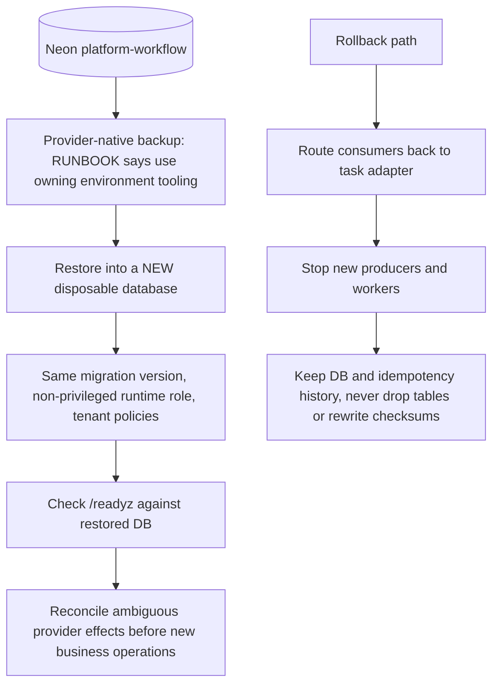

# 14 — Backup & DR

## Data inventory

| Data | Where | Owner | Backup in repo |
|---|---|---|---|
| `workflow_jobs` (payload, result, status, idempotency keys) | Neon project `platform-workflow` | this service | none |
| `workflow_attempts` (attempt history) | same | this service | none |
| `platform_schema_migrations` (namespace `workflow`) | same | core MigrationRunner | none |
| Secrets (DSN, JWT settings, Sentry DSN, worker key) | Infisical `/platform-workflow`, Railway variables | owner | n/a |
| Scheduler inventory fixtures | git `fixtures/gates/` | this repo | git history |

Sources: `src/platform_workflow/migrations.py`, `docs/RUNBOOK.md`, `fixtures/gates/`, ops record: book-platforms-status (2026-11-03) (Neon project, Infisical path)

## Backup / restore reality

Sources: `docs/RUNBOOK.md` ("Diagnose and recover"), `src/platform_workflow/app.py` (`readyz`)

ไม่มี backup workflow ใน `.github/workflows/` และไม่มีคำสั่ง restore ใน repo ("No destructive restore command is included", `docs/RUNBOOK.md`)
RUNBOOK ระบุว่า integrated backup/restore และ load evidence เป็นของ parent infrastructure program

## RTO / RPO

- RTO: **not defined**
- RPO: **not defined**
- Restore drill: RUNBOOK บังคับให้ rehearse ก่อน production release; ไม่พบหลักฐาน drill ใน repo

## Open questions

- nightly encrypted DB backup ไป R2 ที่ใช้กับ prod อื่นครอบคลุม Neon `platform-workflow` หรือไม่ (ไม่มีใน repo และ ops record)
- Neon free project เก็บ point-in-time history ได้กี่วัน
- service live ตั้งแต่ 2026-10-29 แต่ RUNBOOK บอกต้อง rehearse restore ก่อน release — เคยทำหรือยัง
