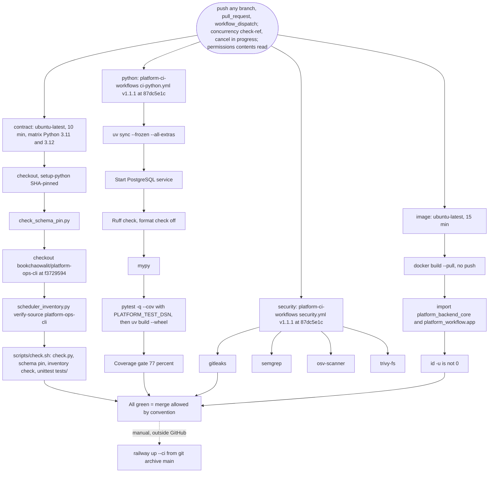

# 15 — CI/CD pipeline

workflow เดียว `.github/workflows/check.yml` (GitHub-hosted, public repo) มี 4 job ที่รันขนานกัน ไม่มี `needs` ระหว่างกัน และ **ไม่มี deploy job**

Sources: `.github/workflows/check.yml`, `scripts/check.sh`, `pyproject.toml` (`[tool.coverage.run]`, `[tool.mypy]`, `[tool.ruff]`), `bookchaowalit/platform-ci-workflows` `.github/workflows/ci-python.yml` and `security.yml` at `87dc5e1c` (step and job names read via `gh api`), ops record: book-platforms-status (2026-11-03) (deploy recipe)

หมายเหตุ

- coverage threshold 77 เป็น ratchet จากค่าวัด 77.89% วันที่ 2026-10-24 ตาม ADR-0004 (TDD/SDD) ของ central architecture ([ADR-0004](https://github.com/bookchaowalit/architecture-docs/blob/main/docs/architecture/decisions/ADR-0004-tdd-sdd-standard.md))
- workflow เก่า `Shared runtime` (มี run ถึง 2026-10-23) ถูกรวมเข้า job `python` แล้ว (comment ใน `check.yml`)
- `tests/test_build_hygiene.py` บังคับว่าทุก `uses:` ต้อง pin ด้วย SHA 40 ตัว

## Open questions

- branch protection / required checks บน `main` ตั้งไว้หรือไม่ (ไม่อยู่ใน repo)
- ควรเพิ่ม deploy job หรือ deploy-smoke หลัง merge แทน `railway up` มือหรือไม่
