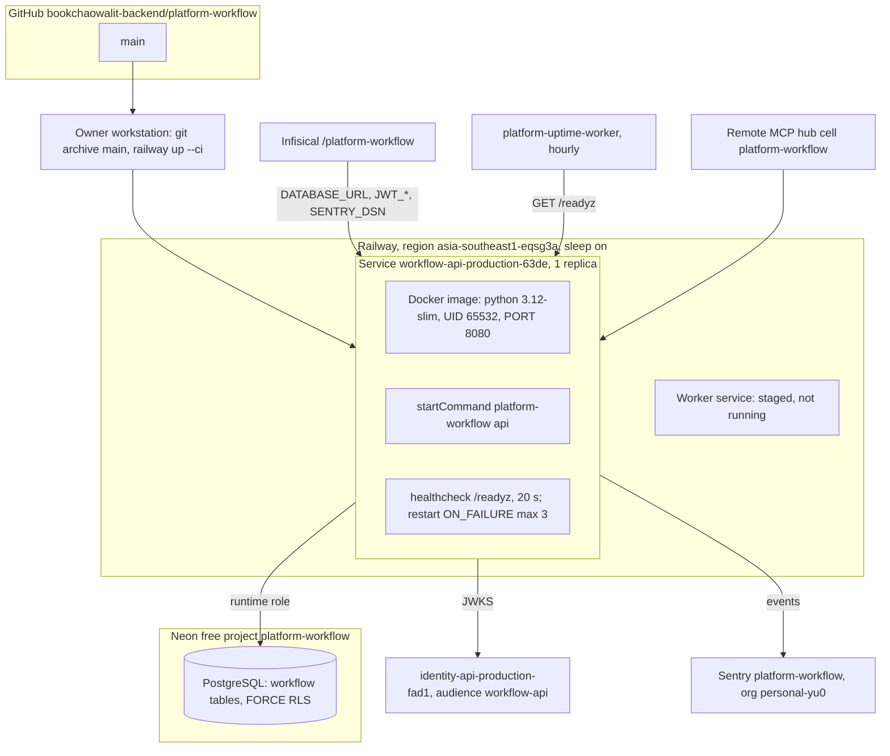

# 16 — Deployment

**ความขัดแย้งของเอกสาร:** `README.md`, `PRODUCT.md`, `docs/RUNBOOK.md`, `docs/RUNTIME.md` ยังเขียนว่า "implemented-local, not deployed" แต่ ops record บันทึกว่า service นี้ live บน Railway ตั้งแต่ 2026-10-29 และ redeploy main `301da88` เมื่อ 2026-11-03 (CLI, `/readyz` 200, `sentry: enabled`)
ภาพนี้ใช้ config ใน repo + บรรทัดใน ops record ที่ระบุ workflow เท่านั้น

Sources: `.railway/railway.ts`, `Dockerfile`, `src/platform_workflow/cli.py`, `docs/RUNBOOK.md`, ops record: book-platforms-status (2026-11-03) (service name, region, sleep, Neon project, Infisical path, Sentry project, uptime worker, MCP hub, identity issuer `https://identity-api-production-fad1.up.railway.app`, audience pattern `<svc>-api`, "The workflow worker token" follow-up)

## Health endpoints

| Path | Source | Checks |
|---|---|---|
| `/healthz` | core `create_app` | process alive, always `{status: ok}` |
| `/readyz` | `app.py` (replaces core probe) | DB reachable, both tables, schema USAGE, SELECT/INSERT/UPDATE, RLS enabled + forced → 200 or 503 |
| `/metrics` | core | redacted counters |

serverless sleep: request แรกหลัง sleep ต้องปลุก container และ Neon (~6–9 s ตาม ops record); core ตั้ง pool wait 20 s และ connect timeout 15 s เพื่อรองรับ (`platform-backend-core@dc1fa7d:src/platform_backend_core/db.py`)

## Environments

มีแค่ production บน Railway; `SENTRY_ENVIRONMENT` default `production` (`_sentry.py`); ไม่มี staging ใน repo หรือ ops record

## Open questions

- public URL เต็มของ service และมี custom domain หรือ gateway route หรือไม่
- audience จริงคือ `workflow-api` ตาม pattern หรือไม่ (ops record ให้แค่ pattern)
- อัปเดต README/PRODUCT/RUNBOOK ให้ตรงกับสถานะ live (doc drift)
