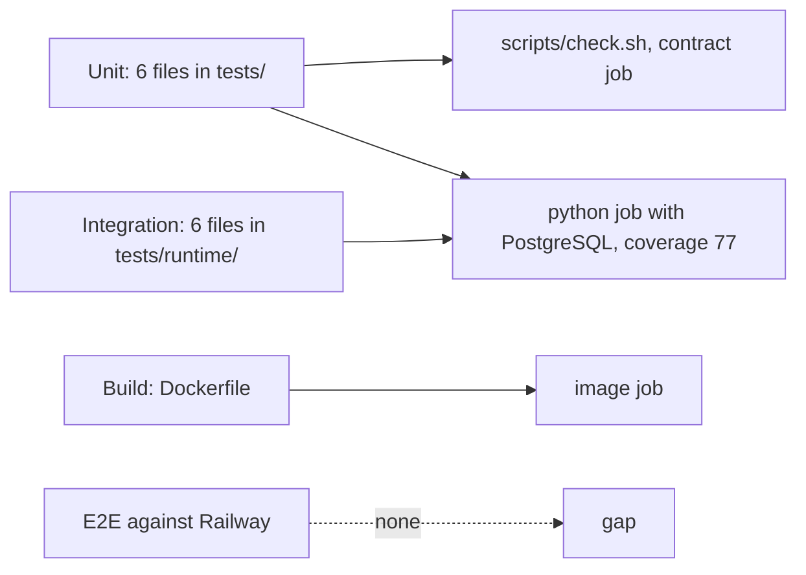

# 17 — Test coverage matrix

ระดับที่ใช้ใน repo: **unit** (`tests/*.py`, unittest, offline, ใน `scripts/check.sh`), **integration** (`tests/runtime/*.py`, pytest กับ PostgreSQL จริงผ่าน `PLATFORM_TEST_DSN`; บางไฟล์ใช้ fake DB), **build** (job `image` ใน CI), **e2e** ไม่มี (ไม่มี test ยิง Railway deployment)
coverage รวมที่วัดล่าสุด 79% (gate 77) ตาม `docs/RUNTIME.md` 2026-10-29

| Feature | Unit | Integration | Build / CI | E2E | Gap |
|---|---|---|---|---|---|
| Enqueue + idempotency | – | `test_jobs.py` idempotency, concurrent enqueue | – | – | – |
| Workspace isolation / RLS | – | `test_jobs.py` workspace isolation, missing context; `test_app_worker.py` scope + workspace | – | – | – |
| Claim / lease fencing | – | `test_jobs.py` independent processes, expired lease fencing | – | – | – |
| Retry, backoff, dead-letter | – | `test_jobs.py` backoff/dead-letter, expired final attempt | – | – | – |
| Cancel | – | `test_jobs.py` cancellation | – | – | – |
| Completion replay | – | `test_jobs.py` scientific notation replay | – | – | – |
| Input bounds / 422 vs 500 | – | `test_error_mapping.py` (fake DB), `test_jobs.py` bounds, JSONB expansion, unicode; `test_app_worker.py` 422 | – | – | – |
| Readiness | – | `test_app_worker.py` missing schema, each privilege | – | – | no test for `/readyz` on live host |
| Worker loop + heartbeat | – | `test_app_worker.py` handlers, renew, invalid result | – | – | CLI `main()` worker loop and signal handling not tested |
| Worker token source | – | `test_worker_authorization.py` (stubbed identity post) | – | – | no test against real identity |
| Sentry scrub | `test_sentry.py` (12) | `test_sentry_boundary.py` 500 path + 55-case no-text test | – | – | – |
| Contract + schema pin | `test_contract_check.py` (19), `test_drift_checks.py` | – | `contract` job | – | – |
| Scheduler inventory BOO-165 | `test_scheduler_inventory.py` | – | `contract` re-extracts platform-ops-cli | – | solo-empire re-extraction local only |
| Build hygiene / image | `test_build_hygiene.py` | – | `image` job build + import + non-root | – | – |
| Migrations runner | – | used by runtime fixtures | – | – | no test of `platform-workflow migrate` CLI |
| `/metrics`, `/healthz` | – | – | – | – | owned by core, not tested here |
| Approval, recurring schedule | – | – | – | – | no code, no test |
| Migration-gate fixtures (success, duplicate delivery, timeout, provider failure) | – | – | – | – | missing (`README.md` "Migration gate") |

Sources: `tests/test_*.py`, `tests/runtime/test_*.py`, `scripts/check.sh`, `.github/workflows/check.yml`, `pyproject.toml` (`[tool.coverage.run]`), `docs/RUNTIME.md` ("Local verification", GREEN notes)

Sources: `.github/workflows/check.yml`, `tests/`

## Open questions

- ต้องการ smoke test หลัง deploy (`/readyz` + enqueue/claim `health.noop` ใน workspace ทดสอบ) หรือไม่
