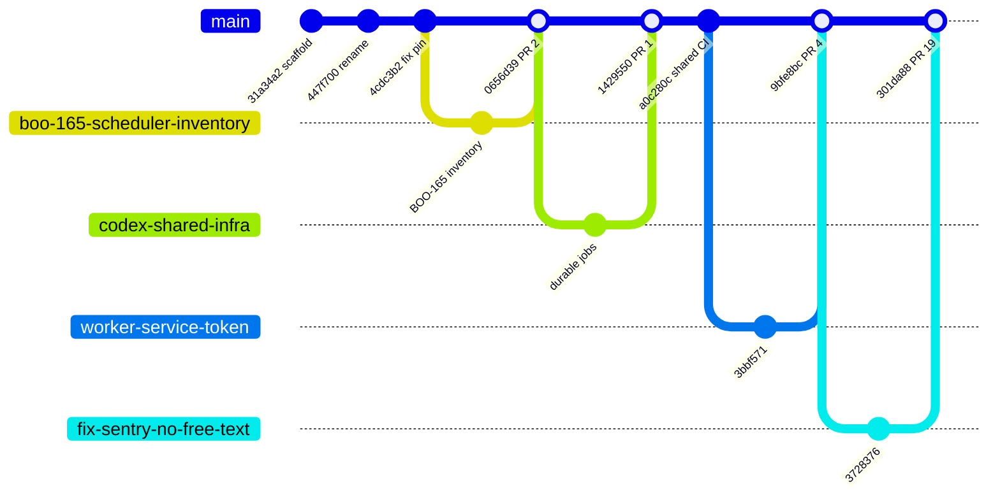
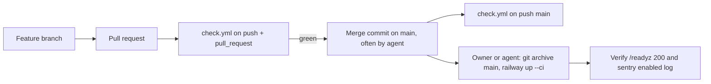

# 18 — Git & release workflow

จาก `git log --first-parent origin/main` และ `gh pr list`: งานส่วนใหญ่ทำบน feature branch → PR → CI `Check` เขียว → merge commit `Merge PR #n` บน `main`; บางครั้งเป็น merge branch ตรง (`Merge branch 'sentry'`, `Merge core pin 21d5f44`) หรือ commit ตรงบน main (`a0c280c`, ก่อน 2026-10-16)
ไม่มี tag หรือ GitHub release; deploy เป็นขั้นมือ `railway up --ci` จาก `git archive main`

Sources: `git log --first-parent --format='%h %ad %s' origin/main`, `gh pr list -R bookchaowalit-backend/platform-workflow --state all`

Sources: `.github/workflows/check.yml`, `git log`, ops record: book-platforms-status (2026-11-03) (deploy recipe, "all CLI-deployed, /readyz 200, `sentry: enabled` logged")

ข้อสังเกต: PR #1 แสดงสถานะ CLOSED ใน GitHub แต่เนื้อหาเข้า main ผ่าน branch `codex/shared-infrastructure-20261015-rebased` เป็น `1429550`; PR #5 (`sentry-hardened-scrubber`) ยัง OPEN และถูก supersede แล้ว (ops record)

## Open questions

- ปิด PR #5 ที่ค้างหรือไม่
- ควร tag release ต่อ deploy (เช่น ใช้ `RAILWAY_GIT_COMMIT_SHA` ที่ Sentry อ่านอยู่แล้ว) เพื่อให้ RTM/DORA ตามได้หรือไม่
