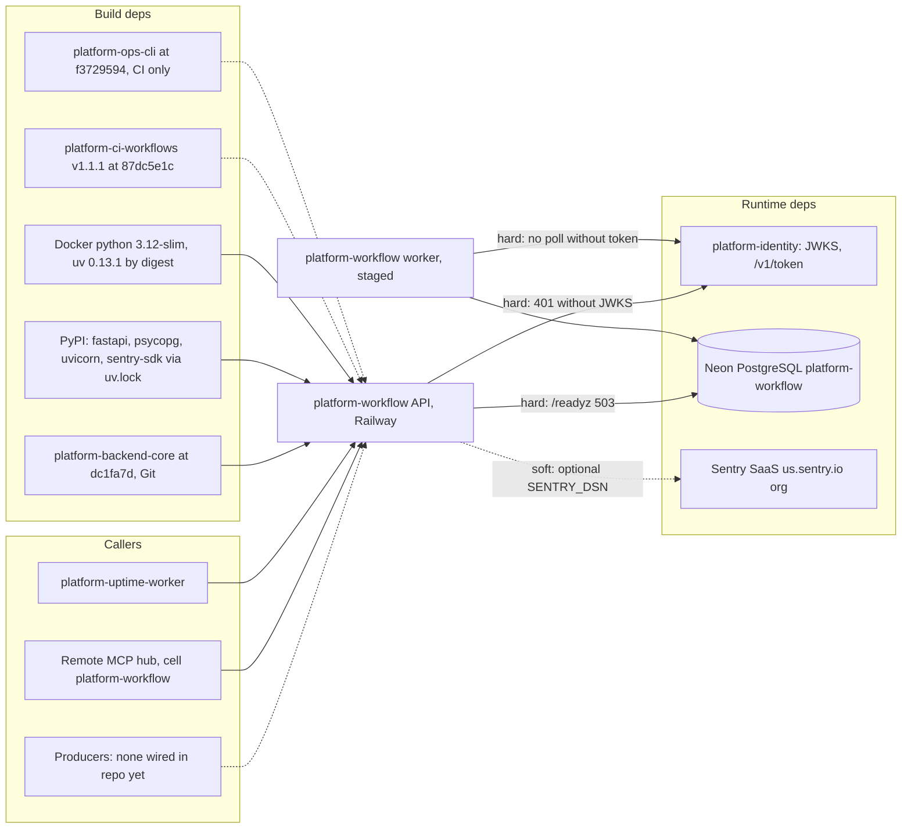

# 19 — Service dependency map

| Dependency | Type | Failure effect | Source |
|---|---|---|---|
| platform-identity JWKS | runtime, hard | every `/v1/*` → 401 | `cli.py` `verifier_from_env`, core `auth.py` |
| platform-identity `/v1/token` | runtime, hard (worker) | worker skips polls, retries every 30 s | `cli.py` `worker_principal` |
| Neon PostgreSQL | runtime, hard | `/readyz` 503, requests 500/504 | `app.py`, core `db.py` |
| Sentry | runtime, soft | no error reports | `_sentry.py` |
| platform-backend-core | build | pinned commit; change requires re-lock | `pyproject.toml`, `uv.lock` |
| platform-ci-workflows, platform-ops-cli | CI | CI red | `.github/workflows/check.yml` |
| `observability` platform | declared in `contract.json` | none in code | `contract.json` |

Sources: `src/platform_workflow/cli.py`, `src/platform_workflow/app.py`, `src/platform_workflow/_sentry.py`, `pyproject.toml`, `Dockerfile`, `.github/workflows/check.yml`, `contract.json`, ops record: book-platforms-status (2026-11-03) (MCP hub, uptime worker, Neon project, Sentry `us.sentry.io`)

## Open questions

- service ไหนจะเป็น consumer ตัวแรก (ยังไม่มีใน registry ที่อ่านได้จาก repo)
- identity sleep ด้วย; cold start ต่อกันสองชั้น (workflow + identity JWKS) ใช้เวลารวมเท่าไร
