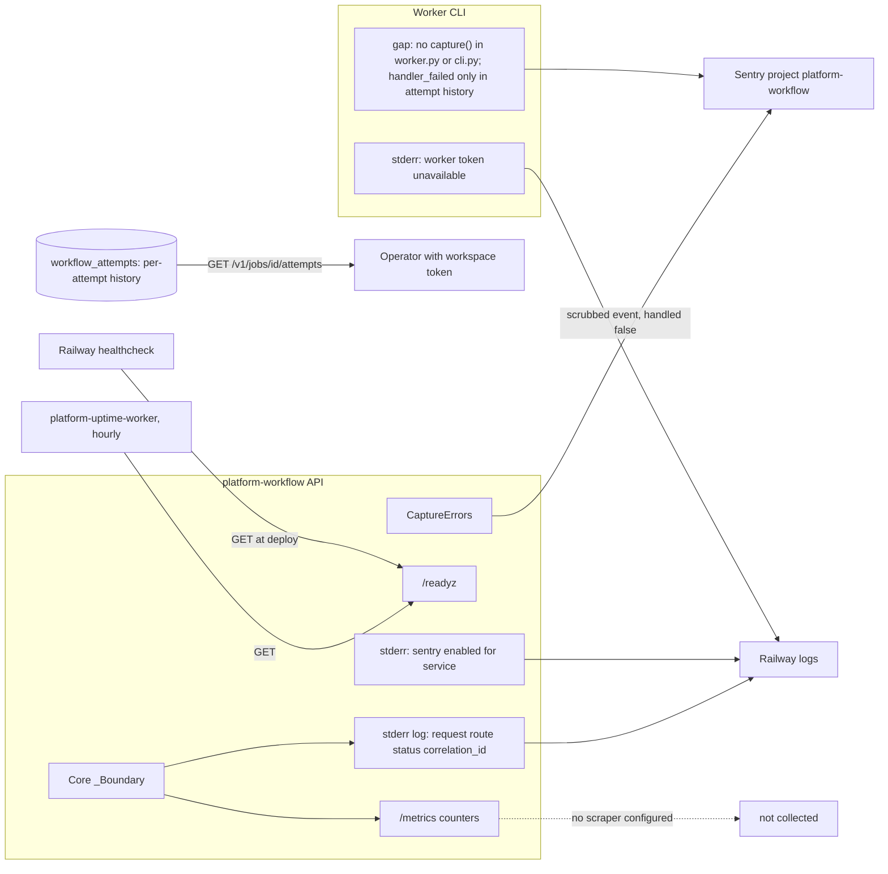

# 20 — Observability

Sources: `src/platform_workflow/_sentry.py`, `src/platform_workflow/app.py`, `src/platform_workflow/cli.py`, `platform-backend-core@dc1fa7d:src/platform_backend_core/http.py` (`_LOG.info`, metrics), `.railway/railway.ts`, `docs/RUNBOOK.md`, ops record: book-platforms-status (2026-11-03) (uptime worker hourly `/readyz`, Sentry project, "Observability repo is an instrumentation library ... owner decision pending (a scraper would keep sleeping services awake)")

## What is watched

| Signal | Collected by | Alert |
|---|---|---|
| `/readyz` | platform-uptime-worker hourly (sleeping set) | per uptime worker config (outside repo) |
| Unhandled exceptions (API 500, worker) | Sentry `platform-workflow` | Sentry alert rules (outside repo) |
| HTTP counters `/metrics` | none | none |
| Request log with correlation id | Railway logs | none |
| Queue age, dead-letter growth, connection exhaustion | **not collected** | RUNBOOK says "Alert on" these, but no collector exists; needs per-workspace polls |

ไม่มี PostHog, ไม่มี heartbeat ใน repo นี้

## Open questions

- alert ของ uptime worker และ Sentry ส่งไปช่องไหน (Telegram?) — ไม่อยู่ใน repo
- จะวัด queue age / dead-letter อย่างไรโดยไม่ปลุก service ที่ sleep (เกี่ยวกับ owner decision เรื่อง observability)
