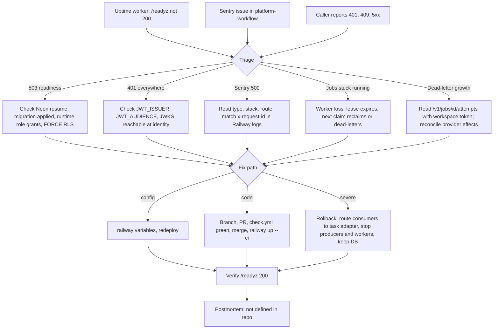

# 21 — Incident response

ขั้นตอน diagnose/recover จริงอยู่ใน [docs/RUNBOOK.md](../RUNBOOK.md) "Diagnose and recover" (reused); ภาพนี้ต่อจาก alert channel ที่พบจริง

Sources: `docs/RUNBOOK.md`, `src/platform_workflow/app.py`, `src/platform_workflow/store.py` (lease reclaim, dead-letter), `src/platform_workflow/_sentry.py`, `platform-backend-core@dc1fa7d:src/platform_backend_core/http.py` (`x-request-id`), ops record: book-platforms-status (2026-11-03) (uptime worker, Sentry project, deploy recipe)

ข้อจำกัดที่ RUNBOOK ระบุ: ไม่มี automated replay ของ dead-letter; ไม่มี endpoint cross-workspace สำหรับดู backlog รวม

## Open questions

- severity, on-call และ template postmortem ยังไม่กำหนดใน repo
- ปลายทาง alert ของ uptime worker และ Sentry
