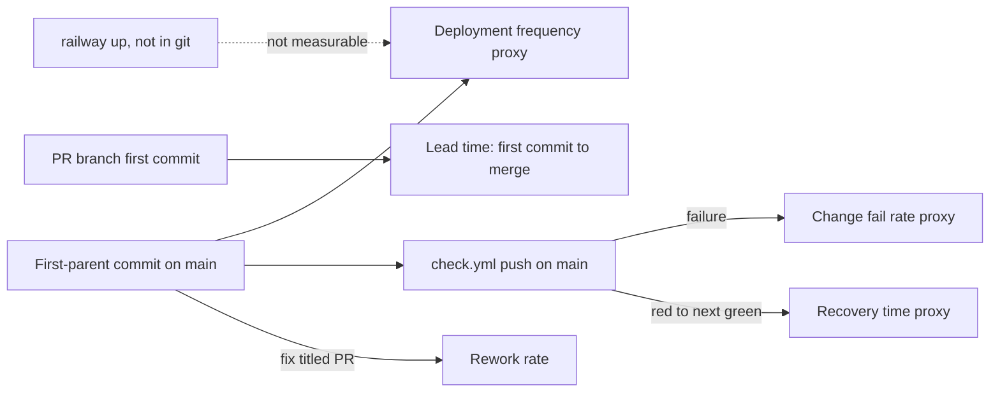

# 22 — DORA metrics

ช่วงวัด: 90 วัน **2026-08-05 → 2026-11-03** (repo เริ่ม 2026-09-17 `31a34a2`) วัดจาก `origin/main` ที่ fetch แล้ว และ `gh run list -R bookchaowalit-backend/platform-workflow`

**ข้อจำกัดหลัก:** deploy ทำด้วย `railway up --ci` จากเครื่อง owner/agent (ops record) จึงไม่มี deploy event ใน git หรือ GitHub Actions; service live ตั้งแต่ 2026-10-29 เท่านั้น
ค่าด้านล่างใช้ **merge/commit เข้า main** เป็น proxy ของ deployment และ CI `Check` บน main เป็น proxy ของ change failure

| Metric | How measured here | Value (90 days) | Command |
|---|---|---|---|
| Deployment frequency | first-parent commits on `origin/main` (proxy; real deploys are CLI) | **32 changes on 12 distinct days**; 13 on 2026-11-03, 6 on 2026-10-29 | `git log --first-parent --since=2026-08-05 --format='%ad' --date=short origin/main \| sort \| uniq -c` |
| Lead time for changes | author time of first commit on the merged branch → merge commit time, 22 merges | **median 4.5 min**; 20 of 22 at or under 20 min; outliers 518 min (`4a7a70a`) and 12085 min (≈ 8.4 days, `1429550` PR #1) | `for m in $(git log --first-parent origin/main --since=2026-08-05 --merges --format=%h); do f=$(git log --reverse --format=%at $m^1..$m^2 \| head -1); t=$(git log -1 --format=%ct $m); echo "$m $(( (t-f)/60 ))"; done` |
| Change fail rate | `Check` push runs on `main` with `conclusion=failure` | **2 / 31 = 6.5 %** (`447f700`, `4786e54`, 2026-10-13, rename to platform-*) | `gh run list -R bookchaowalit-backend/platform-workflow --branch main --limit 100 --created '>=2026-08-05' --json conclusion,headSha` |
| Failed deployment recovery time | first red `Check` on main → next green on main | **≈ 2 h 1 min** (03:36:52Z → `4cdc3b2` 05:37:53Z, 2026-10-13); production incidents: not measurable (no deploy/incident record) | same `gh run list` ordered by `createdAt` |
| Deployment rework rate | merged PRs/commits on main whose title starts with `fix` | **15 / 32 = 46.9 %** by title (PR #6–#19 `fix(sentry)` + `4cdc3b2`); 13 / 32 = 40.6 % counting only reworks of an earlier main change (PR #7–#19 reworked the scrubber from PR #6) | `gh pr list -R bookchaowalit-backend/platform-workflow --state merged --json title --jq '.[].title' \| grep -c '^fix'` and `git log --first-parent --since=2026-08-05 --format=%s origin/main \| grep -c '^fix'` |

Sources: `git log origin/main`, `gh run list` (31 main runs, 58 branch runs in window), `gh pr list --state all`, `.github/workflows/check.yml`, ops record: book-platforms-status (2026-11-03) (CLI deploys, live since 2026-10-29)

## What git/gh can and cannot show

- **ได้:** merge เข้า main, เวลา PR, ผล CI ต่อ SHA
- **ไม่ได้:** SHA ไหนถูก `railway up` และเมื่อไร, deploy ล้มหรือไม่, เวลาฟื้นจาก incident production; Railway deployment history และ Sentry release (`RAILWAY_GIT_COMMIT_SHA`) คือแหล่งที่ควรใช้แทน
- PR #6–#19 ถูก merge ทีละตัวในคืนเดียว (2026-11-02/03) จาก review loop จึงดัน deployment frequency และ rework rate สูงผิดปกติ

## Open questions

- ดึง Railway deployment list (`railway` GraphQL `deployments`) มาเป็นแหล่ง deployment frequency / change fail จริงหรือไม่
- นิยาม "failed deployment" สำหรับ service นี้: `/readyz` 503 หลัง deploy? Sentry issue ใหม่ภายใน N ชั่วโมง?
